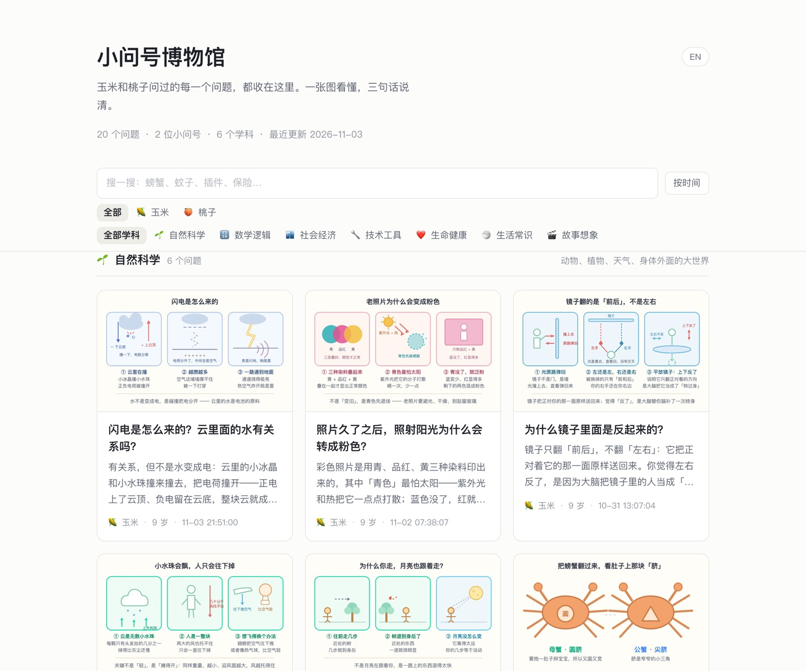
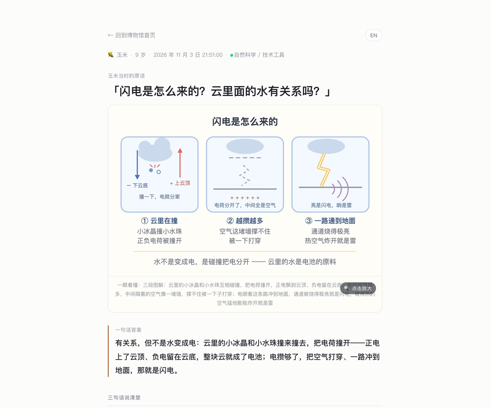

# 小问号博物馆：把孩子每天的提问，做成一座看得见的博物馆

**关键词**：儿童提问、静态站点、图解卡片、中英双语、成长记录

玉米九岁，桃子四岁。她们每天都在问问题，我们讲完就散了。这一篇介绍我们为此做的一个小产品：一个零依赖的静态网站，把两个孩子随口问出的问题收进去、按学科分好、每题配一张一眼能看懂的图。全文按「为什么做 → 它是什么 → 三条设计原则 → 怎么用 → 技术取舍 → 下一步」展开，附两张真实截图。

## 核心结论（30秒速览）

> **核心结论**：我们把玉米和桃子每天随口问的问题收进一个静态小站，按学科分好，每题配一张一眼能看懂的图。一个月下来攒了 20 个问题、7 个学科，孩子自己能翻、能搜、能换成英文看，我们也能顺着时间看清她们在关注什么。

## 一、起因：问题太多，接不住

问题来得又快又碎：螃蟹怎么分公母、保险公司赔了钱怎么还赚钱、闪电是怎么来的。

道理讲完就散了，问题本身也散了。我们真正想要的其实是两件事：**当时能给孩子一个听得懂的答案**，以及**过几年还能回看她们是怎么想的**。

前者是聊天，后者需要沉淀。所以先把提问记进长期档案（原始记录、索引、成长报告），再从这个档案里长出一个小站，专门给孩子看。

**关键洞察**：孩子的提问本身是易耗品，不落盘就等于没发生过。记录要快到不打断对话，加工可以慢到晚上再做。

## 二、这个产品是什么

一个纯静态网站，线上地址 https://baixiaoustc.github.io/kids/，本地仓库在 `~/Code/kids-questions-site`。

首页是一面卡片墙：按学科分组，每张卡一个问题加一张小图，顶部搜索框，下面两排筛选条（按小朋友、按学科），右上角一个中英切换按钮。默认按学科聚，也可以一键切成「按时间」的全站倒排。



点开一张卡进详情页，顺序固定为五段：大图 → 一句话答案 → 三句话说清楚 → 还可以接着问 → 同学科的推荐。没有登录、没有广告、没有推荐算法，只放我们想给孩子看的东西。



### 现在的数据

| 维度 | 现状 |
|---|---|
| 问题总数 | 20 题 |
| 学科 | 7 个（自然科学、数学逻辑、社会经济、技术工具、生命健康、生活常识、故事想象） |
| 来源分布 | 玉米 15 题、桃子 5 题 |
| 时间跨度 | 2026-10-06 至 2026-11-03 |
| 图解 | 20 张中文 SVG + 20 张英文 SVG，全量覆盖 |
| 依赖 | 零。没有构建工具、没有框架、没有后端 |

表格里最值得看的是最后一行。整个站点就是几个 HTML 文件加一批 SVG，拷到任何一台机器、任何一个静态托管上都能跑，十年后大概率还能打开。

## 三、三条设计原则

**第一，图和字各说一半。** 每道题必须配一张 640×400 的手绘 SVG，只用圆、矩形、直线这类简单形状。一图只讲一件事：讲闪电就画碰撞把电荷撞开、空气被打穿、通道烧亮，不画云的分类学。

**第二，答案只有三句。** 一句话答案放最前面，孩子扫一眼就懂；下面三句展开，写多了就变成作文，孩子不会读。真想往下追，末尾留一个「还可以接着问」，把好奇心递回去。

**第三，收和编分开。** 家长在饭桌上听到一个问题，用一条命令丢进收件箱，几百毫秒完成，不调模型、不分类、不改原话。补答案、画图、翻译都可以晚上慢慢做。

这条原则解决的是真实痛点：灵感来得急，加工来得慢。如果「记录」这一步要等模型想三秒，很多问题就在这三秒里丢了。

## 四、怎么用

给家长用，是三步命令行：

```bash
# ① 收：原文一字不改，自动认人、自动去重
node tools/capture.mjs "玉米今天问：为什么天是蓝的" --date 2026-10-28

# ② 编：补答案和 figure 路径，没图也能先上
node tools/publish.mjs draft.json

# ③ 发：生成站点数据并同步进博客仓库推送
./deploy.sh --push
```

给孩子的用法就走界面：搜「螃蟹」、点「自然科学」、按「桃子」筛，或者点右上角把整站切成英文。

站点支持中英双语，不是机翻：每条题目的英文是一个独立字段，图解的中英对照单独存在一份译稿里，跑脚本生成英文 SVG。缺英文时自动退回中文，不会出现半截英文的页面。分享链接带 lang=en 可以直接进英文版，选择记在浏览器本地。

**关键洞察**：双语的关键不是翻译工具，而是给每条内容留出独立的英文字段。缺了就退回中文，这让加译文的节奏可以完全独立于写中文。

## 五、技术上做了什么取舍

我们刻意不做数据库、不做后台、不做账号体系。数据事实源只有两个文件：问题清单 `data/questions.json` 和收件箱 `data/inbox.ndjson`，站点运行时读的 `data/questions.js` 由脚本生成，禁止手改。

| 选择 | 放弃的东西 | 换来的东西 |
|---|---|---|
| 纯静态 | 后台编辑、多人协作 | 零运维、零成本、永不过期 |
| 手工 SVG | 自动配图、生成式插画 | 风格统一、体积小、离线可用 |
| 命令行录入 | 手机端随手记 | 几毫秒的捕捉速度 |
| 双语字段分开存 | 一键全自动翻译 | 译文可控，图示能按宽度调字号 |

配图这块有一点小工程：英文比中文长，生成脚本会按可用宽度自动缩字号，缩到 10px 还放不下就把句子改短，或在译稿里单独指定坐标和字号。这类细节不做，英文版就会到处溢出。

质量检查也脚本化了：起一个干净的无头 Chrome，用 CDP 量页面尺寸，中英两版都检查水平溢出、图片加载、文字截断、SVG 越界，不装任何 npm 包。

## 六、下一步

眼下能做且值得做的三件事：给每位小朋友一页成长时间线，看关注点从「螃蟹分公母」迁移到「闪电和电荷」的轨迹；给图解加打印样式，直接打成 A4 小卡片；把封面生成工具接进来，一键出竖版分享图。

真正想长期验证的其实是一个朴素假设：**孩子的问题值得被认真对待，而且值得被画出来。**

## 画图建议

一句话 prompt：一个温暖的儿童博物馆展厅，墙面上一排排装裱好的画框，每个画框里是一张小小的手绘图解（一只螃蟹、一朵带电的云、一枚硬币），两个小女孩站在展厅中间仰头看，其中一个伸手指着画框，地面有柔和的光斑；风格为扁平插画加细线条、暖米色底、低饱和，构图是正视平视、纵深排列的画框墙，传达「孩子随口问出的小问题，被郑重地收藏并展出」。

分项拆解：

- 场景：小型家庭博物馆展厅，白墙、木地板、暖光
- 主体元素：装裱画框里的手绘图解、两个不同身高的小女孩背影或侧影、地面光斑
- 风格：扁平矢量插画、细描边、暖米色与低饱和学科色
- 构图：正视角、画框由近及远排列形成纵深，人物置于中景偏下
- 理念：好奇心被认真收藏，知识一眼能看懂

## 参考资源

- 线上站点：https://baixiaoustc.github.io/kids/
- 站点仓库：`~/Code/kids-questions-site`
- 长期档案与记录规范：`~/.openclaw/skills/kids-questions/`
- 博客仓库中的发布目录：`~/Python/github.com/baixiaoustc/baixiaoustc.github.io/kids`
- 提问深度口径：1 是什么、2 为什么、3 怎么办、4 如果、5 元问题
