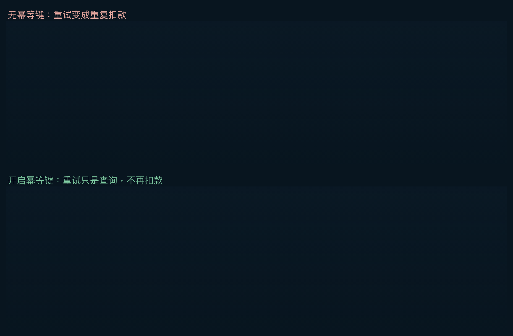
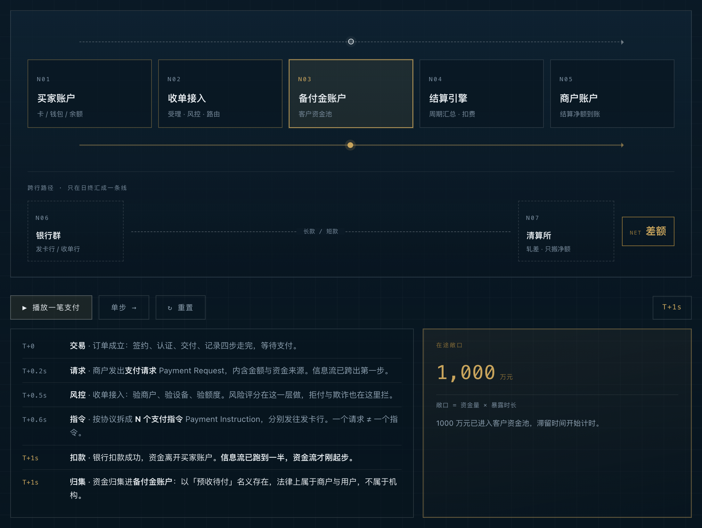
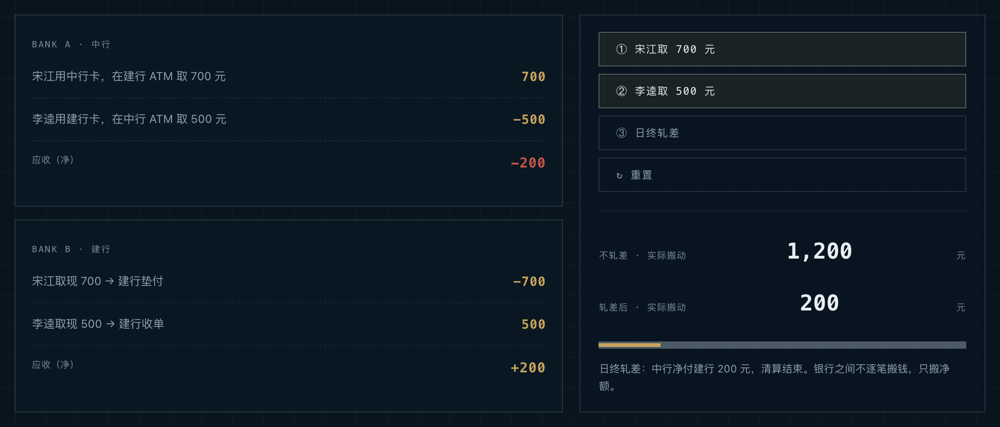
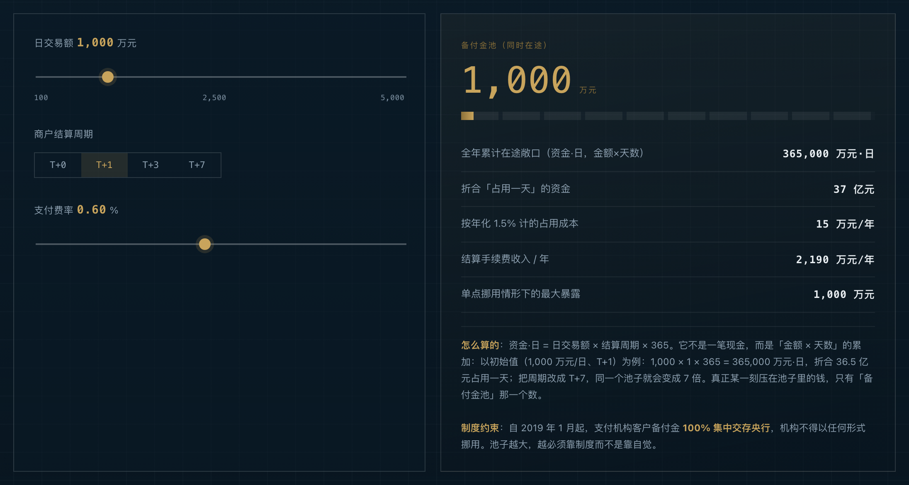
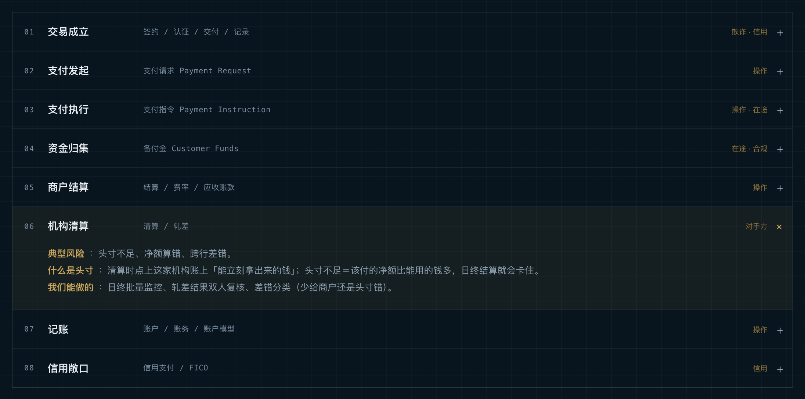
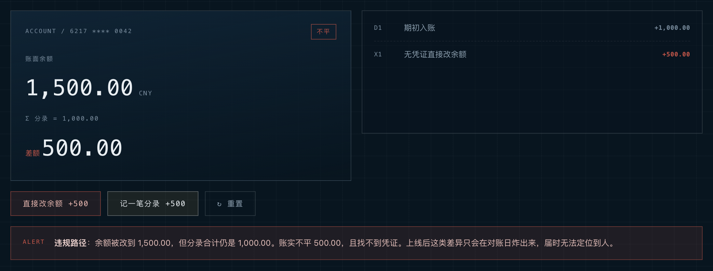

# 一笔钱是怎么走完的：交易、支付、结算、清算

**关键词**: 交易、支付、结算、清算、备付金、支付请求、支付指令、风险敞口

> **核心结论**：我们重读《一本书读懂支付》第 1 章，把四个最常被混用的词分开：交易是买卖的全过程，支付只是最后一步；结算算的是给商户多少钱，清算算的是银行之间谁欠谁。四个词分清，钱在哪、风险在哪，才看得见。

## 1. 四个词，先摆正

先把口径立住，后面所有链路才有地方挂。

- **交易**：买卖双方对有价值的物品和服务互通有无的全过程。它包含签约、认证、交付、记录、支付五步。
- **支付**：付款人向收款人转移「可接受的货币债权」的过程。它是交易五步中的一步。
- **结算**：支付机构按合约周期和费率，对周期内所有支付请求做总结性计算，算给商户。
- **清算**：金融机构相互对长款短款轧差，只转移净额，算在银行之间。

| 词 | 一句话 | 管谁的账 |
|---|---|---|
| 交易 | 互通有无的全过程 | 买卖双方 |
| 支付 | 转移可接受的货币债权 | 付款人 ↔ 收款人 |
| 结算 | 一个周期算总账、扣费、出净额 | 支付机构 ↔ 商户 |
| 清算 | 机构之间轧差，只搬净额 | 金融机构 ↔ 金融机构 |

**关键洞察**：结算是「算给商户多少钱」，清算是「银行之间谁欠谁多少」。混用这两个词，排查资金差错时会直接走错方向。

## 2. 交易五要素：支付排最后，却是闭环开关

交易的五个要素，传统形态和数字形态只是载体不同，要做的事没变。

| 要素 | 要确认什么 | 数字化之后 |
|---|---|---|
| 签约 | 标的、数量、质量、价值、时间地点 | 电子合同、电子签章、智能合约 |
| 认证 | 对手方是不是本人、有没有资质 | 短信、电子身份证、刷脸、声纹 |
| 交付 | 按约定给货或给服务 | 电子转账、数字权益、数字货币 |
| 记录 | 留下纠纷与审计要用的证据 | 电子发票、链上数字发票 |
| 支付 | 按约定的时间、币种、金额、方式付钱 | 电子转账、数字钱包 |

前四步做得再漂亮，支付失败，交易就失败。支付排在最后，但它是唯一能让前四步闭环的一步。

顺带分清两种特殊情况：有支付、没交易，比如还债、慈善捐赠、缴罚款；有交易、没支付，比如以货易货，十袋化肥换一个西瓜。

## 3. 支付：转移的不是钱，是「可接受的货币债权」

支付的定义只有一句：付款人向收款人转移可接受的货币债权。三个要素里，前两个是身份，第三个才是条款。

- **付款人**：通常是买方，也可以是第三方代付，甚至是一台智能设备。
- **收款人**：通常是卖方，电商场景里常被支付机构代收。
- **可接受的货币债权**：由四个约定组成，支付时间、支付货币、支付金额、支付方式。

**关键洞察**：「可接受的」三个字不能删。货币的形态一直在变，从贝壳、金银、纸币走到数字货币，唯一没变的是「双方都认」。对方不认的凭证，做得再精致，支付也不成立。

资金安全的大部分事故，都发生在这四个约定被违约、被误解、被篡改的地方。时间被拖长，就是在途敞口被拖长；币种写错，就凭空多出一层汇率风险。

工程上还有一处必须分清：支付请求和支付指令不是一回事。请求是商户发给支付机构的「请处理这笔钱」，指令是支付机构发给银行的具体划款命令。按协议约定，一个请求可以拆成多个指令，于是就有了「部分成功」。所以幂等键要落到指令级，监控也要盯指令成功率，而不是只看请求的 QPS。

同一次网络超时，没开幂等键时三次重试变成三次扣款，挂账 200 万；开了幂等键，后两次重试只是查询原结果。

## 4. 钱怎么走：两条流，永远对不齐

一笔钱从买家到卖家，走的是两条并行的流。

- **信息流**：订单 → 支付请求 → 支付机构 → 一个或多个支付指令 → 银行扣款 → 结果回传。快的时候两百毫秒跑完。
- **资金流**：买家账户 → 收单机构 → 备付金账户 → 按结算周期出款 → 商户银行账户。默认要一天，跨行还要更久。

中间经过的七个节点，可以当成一张固定地图：

1. 买家账户：卡、钱包、余额
2. 收单接入：受理、风控、路由
3. 备付金账户：客户资金池
4. 结算引擎：周期汇总、扣费
5. 商户账户：净额到账
6. 银行群：发卡行、收单行
7. 清算所：日终轧差，只搬净额

**关键洞察**：信息流是意图，资金流是事实。两者永远对不齐才是常态，所以对账不是补丁，是资金系统的一等公民。差异要挂账，要能追到具体凭证，不能停在「大概是网络抖动」。

图上播放到「资金归集进备付金」：虚线是信息流，已经跑到 N03；金色实线是资金流，停在 N03；右下角在途敞口显示 1,000 万元。两条线之间的空白，就是钱被时间扣住的地方。

## 5. 结算与清算：是 200 元，不是 200 万元

这一组最容易混，用书里的例子一次讲透。

宋江用中行卡，在建行的 ATM 取 700 元，中行欠建行 700 元；下午李逵用建行卡，在中行的 ATM 取 500 元，建行欠中行 500 元。日终轧差，500 元互相抵消，中行净付建行 200 元。

| 维度 | 结算 | 清算 |
|---|---|---|
| 主体 | 支付机构 ↔ 商户 | 金融机构 ↔ 金融机构 |
| 对象 | 一个周期内的支付请求总额 | 机构间的长款与短款 |
| 结果 | 扣费后的应付净额 + 结算报告 | 轧差后的净额划拨 |
| 频次 | 按合约，日、周、月 | 通常日终批量 |
| 实质 | 代收、计算、转移应收账款 | 割差平衡，减少实际搬运 |

图上两家银行各自记长款短款，日终轧差后只剩 200 元净额；下方两根条，是不轧差与轧差后实际搬动的资金量。

结算也值得记一个具体例子：月结、结算日为每月第一个工作日、费率 0.3%。7 月 100 笔共 1000 万元，8 月 1 日扣 3000 元手续费，付 999.7 万元，附交易明细与结算报告。

**容易读错的地方**：这里全部是「元」级的量。1,200 元的搬动被轧成 200 元，是为了让机制看得清楚；它和后面千万元级的示例不是同一笔账，别混着读。

## 6. 备付金：最大的在途敞口

备付金是支付机构办理客户委托支付时，实际收到的预收待付资金。它不属于机构自己的资产。

三个视角看同一笔钱：

- 商户看：结算周期内即将结算给我的待付资金，是我的应收账款。
- 用户看：钱包余额，或者下单后还没确认收货、托管在第三方的钱。
- 机构看：客户资金，只能代收代付，不能挪用。

池子有多大，一条公式就够：**备付金池 = 日交易额 × 结算周期**。日交易额 1000 万元、T+1 结算，池子里就常年压着 1000 万元；周期改成 T+7，就压七天的交易额。

还有一个经常被误读的数：全年累计在途敞口，单位是「万元·日」。

**它怎么算**：资金·日 = 日交易额 × 结算周期 × 365。它是「金额 × 天数」的累加，不是一笔现金。以日交易额 1000 万元、T+1 为例，一年就是 1,000 × 1 × 365 = 365,000 万元·日，折合 36.5 亿元占用一天。

真正某一刻压在池子里的钱，只有「备付金池」那一个数。资金·日 用来比较代价：结算周期每多一天，这个数就多一整天的交易额。

拖日交易额和结算周期，池子与全年资金·日会一起变。图上是初始值：1,000 万元/日、T+1。

制度上，从 2019 年 1 月起，支付机构客户备付金实行 100% 集中交存央行，机构不得以任何形式挪用。池子越大，越要靠制度，而不是靠自觉。

## 7. 风险敞口：把概念变成八条巡检项

把链路排成一列，每个环节标出该盯什么，这一章就从知识变成了工作清单。

| 环节 | 典型风险 | 我们能做的 |
|---|---|---|
| 交易成立 | 伪造身份、拒付、货钱不同步 | 设备指纹、风险评分、商户准入、订单状态机 |
| 支付发起 | 重复提交、参数篡改、金额与订单不一致 | 幂等键、请求与订单强绑定、金额从订单推导 |
| 支付执行 | 一请求拆多指令后部分成功、重试放大 | 指令级状态机、按指令对账、超时补偿 |
| 资金归集 | 挪用、混同、账实不符 | 账户隔离、100% 交存、余额日切核对 |
| 商户结算 | 费率算错、漏结、重复结算 | 批次可重算可回溯、结算单与明细双向可查 |
| 机构清算 | 头寸不足、净额算错、跨行差错 | 日终批量监控、轧差结果双人复核 |
| 记账 | 借贷不平、直接改余额、冻结解冻错配 | 复式记账强制校验、只允许分录驱动余额 |
| 信用敞口 | 坏账、额度失控、欺诈申请 | 额度与风险分层、拒付率监控 |

「头寸不足」值得单独说一句：头寸是清算时点上这家机构账上能立刻拿出来的钱；头寸不足，就是该付的净额比能用的钱多。它多半不是资不抵债，而是时间错配——资产还在，只是当天没变成可用的现金。后果是日终结算卡住，排队传导给对手方，严重的会拖累整批清算。

矩阵每一行都能展开成「典型风险 + 我们能做的」。图中展开的是机构清算这一行，头寸不足的释义就写在里面。

四类敞口可以记成四条公式：

- 在途敞口 = 资金量 × 滞留时长
- 信用敞口 = 授信余额 × 违约概率 × 违约损失率
- 操作敞口 = 可绕过校验的路径 × 单笔上限
- 对手方敞口 = 净额头寸 × 对手方违约概率

## 8. 三条铁律

如果这一章只记三句话，记这三句。

1. **信息流可以重放，资金流不能重来。** 对外指令必须幂等，内部记账必须能回滚到分录层。
2. **结算错是「少给或多给商户」，清算错是「银行之间头寸错」。** 先分类，再动手。
3. **余额是推导值，不是事实源。** 事实源是分录与流水，账实差异必须能追到凭证。

补一句账户模型的底线：余额只能由分录推导出来。任何直接改余额的路径，都是事故源——当时看着账平了，到对账日会变成一张找不到来源的差异单。

这张图是「直接改余额」之后：余额跳到 1,500.00，分录合计仍是 1,000.00，差额 500.00，系统直接报警。

## 9. 四个自测问题

读完这一章，应该能不看笔记答出下面四题。

1. 交易的五个要素是什么？支付排第几，为什么它决定交易成败？
2. 支付的定义里，「可接受的」三个字为什么不能删？
3. 一个支付请求为什么可能变成多个支付指令？这对幂等设计意味着什么？
4. 结算与清算在主体、对象、结果上有什么区别？用宋江李逵的案例复述一遍 200 元怎么算出来。

## 画图建议

**一句话 prompt**：一张「支付科技、理性、精算」气质的资金链路信息图，深墨蓝底、极细网格纸、等宽字标注的工程图纸风格；画面从左到右排列买家终端、支付机构的三层结构（收单接入、备付金账本、结算引擎）、商户账户、远端银行群与清算所；信息流用细虚线箭头，资金流用实心细线，两者在每一层交汇处都标一个对账点；银行之间只在清算所处汇成一条线，旁边标注「净额轧差」；整体克制，无人物面部，无卡通元素，像一张被认真计算过的凭证。

**分项拆解**：

- 场景：一条横向的资金走廊，左侧窄、右侧宽，暗示钱越走越集中。
- 主体元素：七个编号节点、两条流向线、三个实心对账锚、一枚圆形清算印记。
- 构图：横向 16:9，节点等高排列，纵向留白写两行小字，上行「信息流是意图」，下行「资金流是事实」。
- 色板：深墨蓝底、冷白线、铜金只用于三个关键数字与三个对账点。
- 传达理念：资金系统的秩序感，来自每一笔都能被对上，而不是来自跑得快。

## 参考资源

- 原书：陈斌《一本书读懂支付》第 1 章「支付的基本概念」
- 豆瓣条目：https://book.douban.com/subject/36422205/
- 配套可视化页面（可拖动的资金链路、轧差模拟器、敞口滑杆、幂等重试与账务对照）：[baixiaoustc.github.io/notes/payment-primer/ch01/](/notes/payment-primer/ch01/)

## 附：原书勘误与补充

读原书时顺手记了几处，引用时值得留意。

- 「对薄公堂」应为「对簿公堂」。
- 书中把清算写作 Clearance，业内更常见的是 Clearing，与 Settlement 组成「清算与结算」这对标准搭配。
- FICO 公司名书中写作 FairIssac，规范写法为 Fair, Isaac and Company。
- 书中的信用分档是作者简化，标准 FICO 区间通常为 300 到 850。
- 备付金 100% 集中交存央行是 2019 年后的行业现状，原书未展开，属于我们补充的背景。
