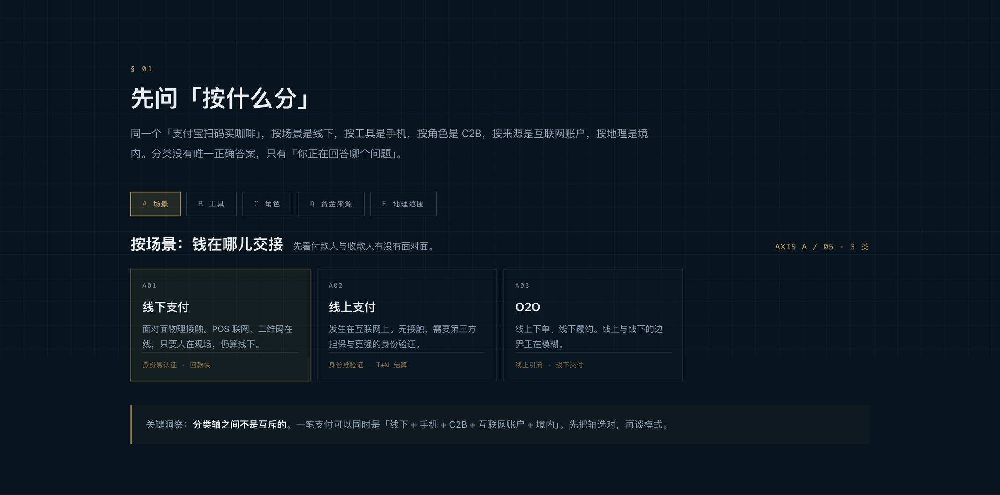
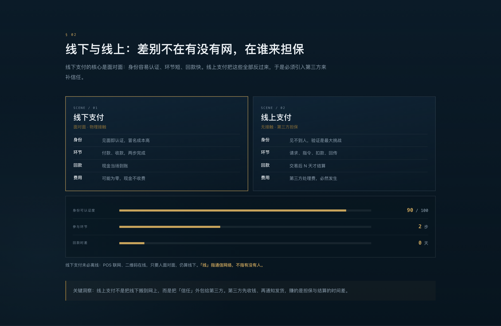
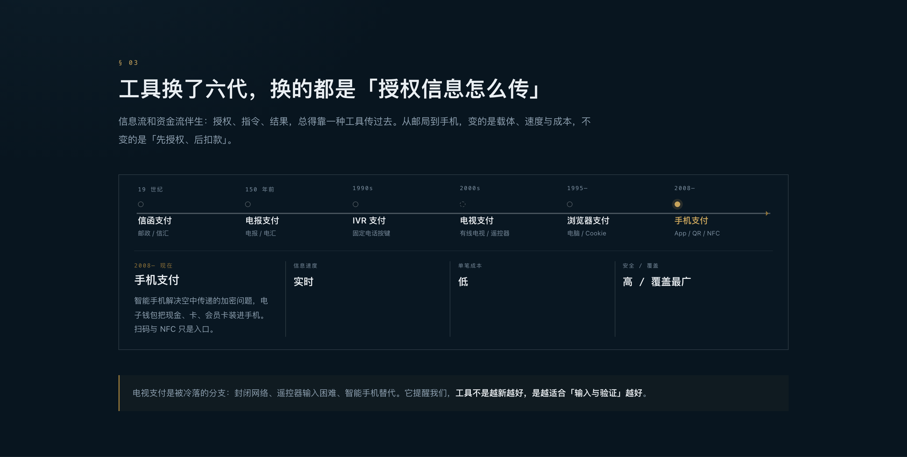
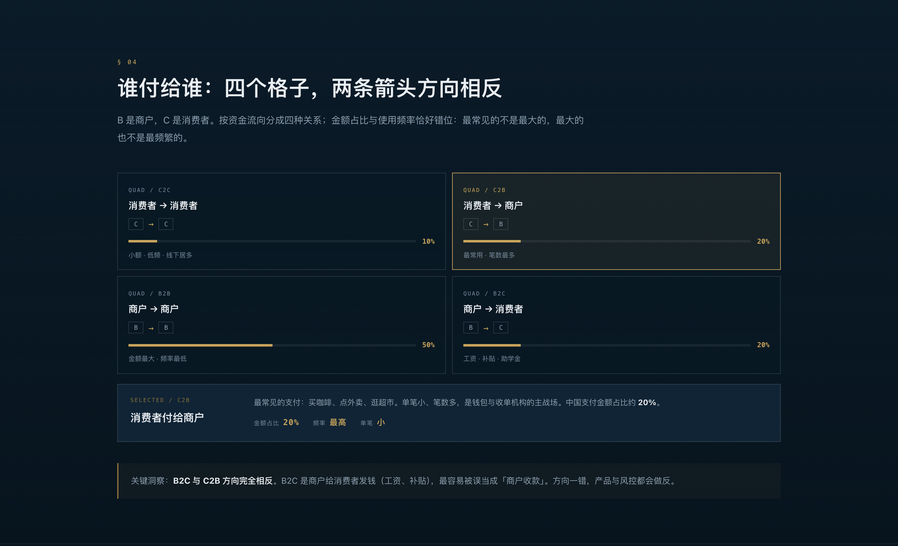
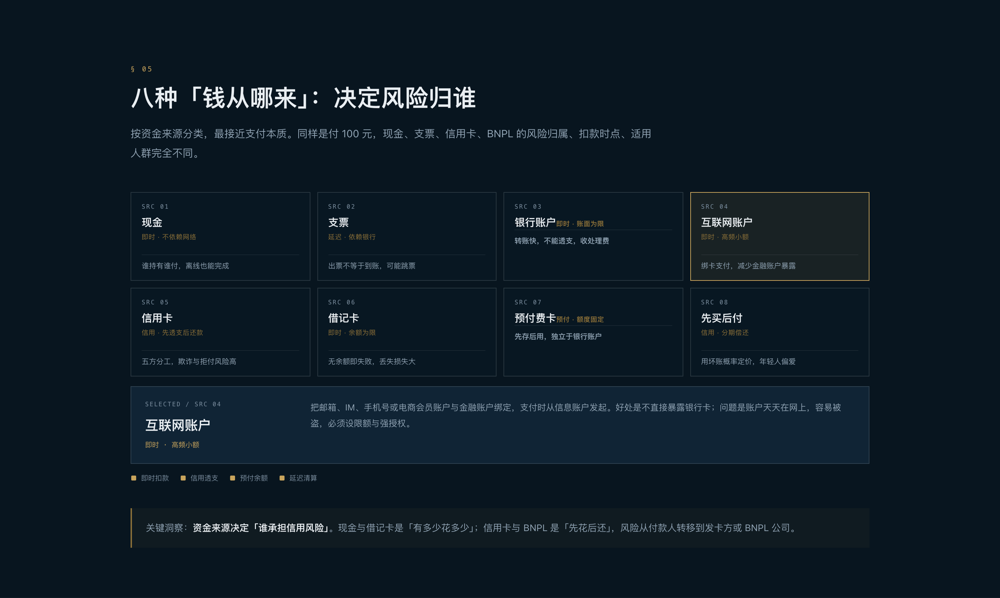
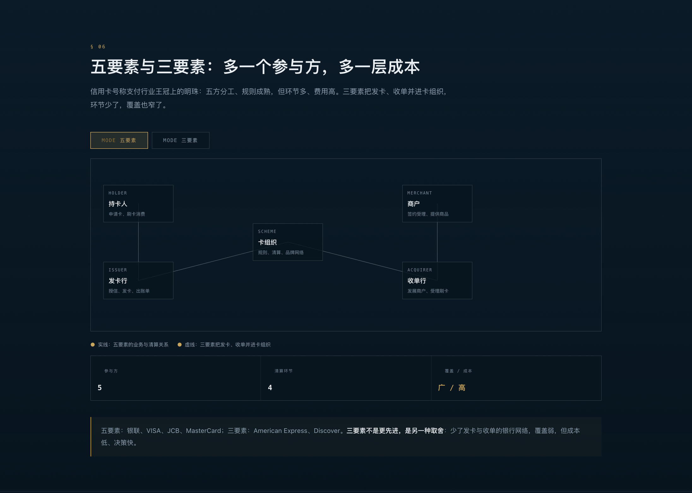
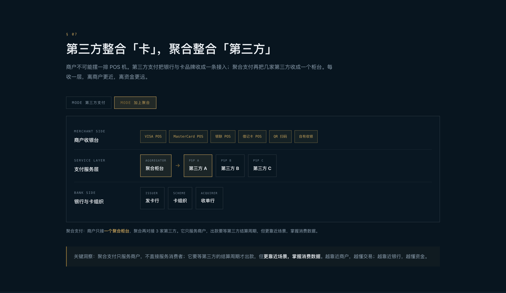
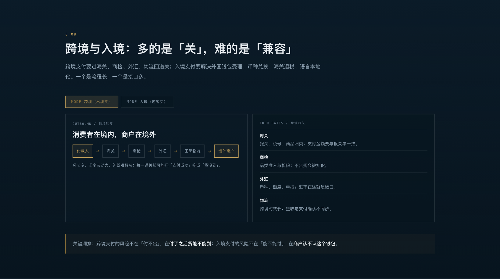
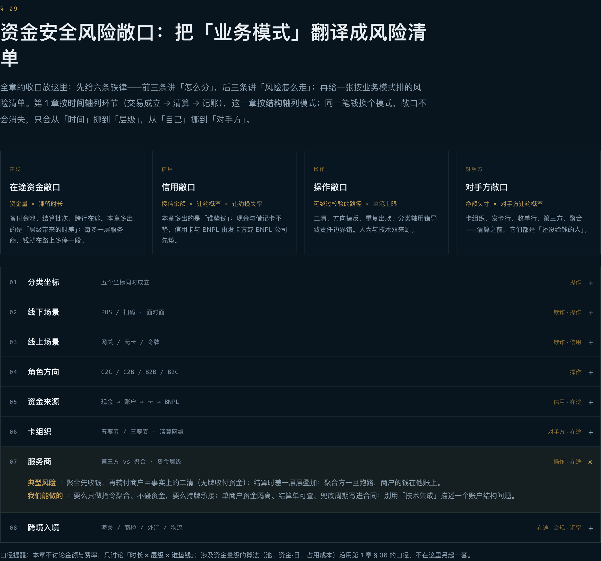

# 同一笔钱，五个坐标：支付的业务模式是怎么分的

支付的业务模式常被列成一串名词：线下、线上、C2B、B2B、信用卡、第三方、聚合。每个都对，但放在一起就打架——问题不在名词，在分类轴。我们把第 2 章的五根轴摆在一起，让同一笔支付能被同时定位，也让风险落到该落的人。

**关键词**: 支付业务模式、场景、资金来源、C2B、B2B、卡组织、第三方支付、聚合支付、风险敞口

> **核心结论**：我们重读《一本书读懂支付》第 2 章，把「支付模式」拆成五根轴：场景、工具、角色、资金来源、地理。一笔支付要五个轴同时有值；最常见的 C2B 不是金额最大的，B2B 才是。轴用错，责任和风险就会落到错的人身上。

## 1. 先问「按什么分」，再问「这是什么支付」

同一个「支付宝扫码买咖啡」，按场景是线下，按工具是手机，按角色是 C2B，按来源是互联网账户，按地理是境内。五个答案都对——因为它们回答的不是同一个问题。

分类没有唯一正确答案，只有「你正在回答哪个问题」。

| 你想回答的问题 | 该用哪根轴 | 同一笔咖啡的答案 |
|---|---|---|
| 钱在哪儿交接、要不要见面 | 场景 | 线下 |
| 授权信息靠什么传 | 工具 | 手机（QR） |
| 谁付给谁 | 角色 | C2B |
| 钱从哪个账户出 | 资金来源 | 互联网账户 |
| 跨不跨国境 | 地理 | 境内 |

**关键洞察**：分类轴之间不互斥。一笔支付可以同时是「线下 + 手机 + C2B + 互联网账户 + 境内」。先把轴选对，再谈模式。

图上五个轴按钮在顶部，当前停在 A 场景，卡片展开为线下、线上、O2O 三类；换一根轴，同一笔咖啡就换一组答案。

落到工程上，一笔支付在资金模型里必须五个字段都有值。只有一个标签的模型，风险一定落错人：把线下当线上做风控，会漏掉终端改装；把 B2C 当收款记，会把钱真付出去。

## 2. 场景：差别不在有没有网，在谁来担保

线下支付的核心是面对面：身份容易认证、环节短、回款快。线上支付把这些全部反过来，于是必须引入第三方来补信任。

| 维度 | 线下支付 | 线上支付 |
|---|---|---|
| 身份 | 见面即认证，冒名成本高 | 见不到人，验证是最大挑战 |
| 环节 | 付款、收款，两步完成 | 请求、指令、扣款、回传 |
| 回款 | 现金当场到账 | 交易后 N 天才结算（T+1 起） |
| 费用 | 可能为零，现金不收费 | 第三方处理费，必然发生 |

线下支付未必离线：POS 联网、二维码在线，只要人面对面，仍算线下。「线」指通信网络，不指有没有人。

**关键洞察**：线上支付不是把线下搬到网上，而是把「信任」外包给第三方。第三方先收钱、再通知发货，赚的是担保与结算的时间差。

工程上，认证强度、限额、对账粒度都要按场景分叉。线下要留得住凭证：订单、工单、签名、监控；线上要顶得住重放与拒付：强授权、风控评分、商户准入、拒付率监控。

左卡线下、右卡线上：线下身份认证 90/100、2 步完成、0 天回款；线上从 T+1 起结算，且必然有第三方处理费。两条卡之间差的，就是「信任被外包」的代价。

## 3. 工具：六代换的都是「授权信息怎么传」

信息流和资金流伴生：授权、指令、结果，总得靠一种工具传过去。从邮局到手机，变的是载体、速度与成本，不变的是「先授权、后扣款」。

| 年代 | 工具 | 输入与验证方式 | 当年的瓶颈 |
|---|---|---|---|
| 19 世纪 | 信函支付 | 纸面信汇、邮局传递 | 慢，几天到几周 |
| 150 年前 | 电报支付 | 电报码、电汇 | 按字计费，信息有限 |
| 1990 年代 | IVR 支付 | 固定电话按键 | 菜单层级深，输错难改 |
| 2000 年代 | 电视支付 | 有线电视、遥控器 | 封闭网络，输入困难 |
| 1995 年起 | 浏览器支付 | 电脑、Cookie | 无卡环境，盗刷与拒付 |
| 2008 年起 | 手机支付 | App、QR、NFC | 入口多，账户与指令更复杂 |

电视支付是被冷落的分支：封闭网络、遥控器输入困难、智能手机替代。它提醒我们，工具不是越新越好，是越适合「输入与验证」越好。

**关键洞察**：换工具不换账本。扫码、NFC、刷脸只是入口，背后仍是账户、授权与扣款指令；入口越多，越要把幂等与对账做在指令层。

时间轴停在 2008 年手机支付：六代载体从左到右排开，电视支付被标灰；下方写的是它为什么被淘汰——封闭网络、遥控器输入困难，不适合「输入与验证」。

## 4. 角色：四个格子，两条箭头方向相反

B 是商户，C 是消费者。按资金流向分成四种关系；金额占比与使用频率恰好错位：最常见的不是最大的，最大的也不是最频繁的。

| 关系 | 方向 | 中国支付金额占比 | 频率与特征 | 典型场景 |
|---|---|---|---|---|
| C2C | 消费者 → 消费者 | 约 10% | 小额、低频、线下居多 | 二手交易、转账 |
| C2B | 消费者 → 商户 | 约 20% | 最常用、笔数最多、单笔小 | 买咖啡、点外卖、逛超市 |
| B2B | 商户 → 商户 | 约 50% | 金额最大、频率最低 | 采购、供应链付款 |
| B2C | 商户 → 消费者 | 约 20% | 工资、补贴、助学金 | 发薪、平台补贴、退款 |

**关键洞察**：B2C 与 C2B 方向完全相反。B2C 是商户给消费者发钱，最容易被误当成「商户收款」。方向一错，产品与风控都会做反。

四格默认选中 C2B：中国支付金额占比约 20%，但笔数最多；B2B 占约 50%，频率最低。两个数字不是同一笔账，别用频率去推金额。

工程上，资金方向要落成枚举字段强制校验，路由、限额、对账、发票都按方向分叉。系统里不允许出现含糊的「收款」二字——收款对谁而言，必须写清。

## 5. 资金来源：八种「钱从哪来」，决定风险归谁

按资金来源分类，最接近支付本质。同样是付 100 元，现金、支票、信用卡、先买后付的风险归属、扣款时点、适用人群完全不同。

| 来源 | 扣款时点 | 谁在垫钱 | 主要风险 |
|---|---|---|---|
| 现金 | 即时，离线也能付 | 没人垫，谁持有谁付 | 丢失、假钞、无痕迹 |
| 支票 | 出票不等于到账 | 收款方先垫信用 | 跳票、空头 |
| 银行账户 | 即时，账面为限 | 没人垫，不能透支 | 余额不足、处理费 |
| 互联网账户 | 即时，高频小额 | 绑卡后由银行扣 | 账户被盗、限额绕过 |
| 信用卡 | 先透支、后还款 | 发卡行垫资 | 欺诈、拒付、坏账 |
| 借记卡 | 即时，余额为限 | 没人垫 | 无余额即失败、丢失损失大 |
| 预付费卡 | 先存后用 | 商户先收钱 | 预付余额是负债、跑路 |
| 先买后付 | 分期偿还 | BNPL 公司垫资 | 坏账、年轻人过度负债 |

**关键洞察**：资金来源决定「谁承担信用风险」。现金与借记卡是「有多少花多少」；信用卡与 BNPL 是「先花后还」，风险从付款人转移到发卡方或 BNPL 公司。

八张卡片按 SRC 01–08 排开，当前选中 SRC 04 互联网账户：绑卡支付，减少金融账户暴露；下方四条轴分别标即时扣款、信用透支、预付余额、延迟清算。

工程上，每种来源都要标三件事：扣款时点、谁垫钱、失败谁承担。预付余额单独记账、不并进自有资金；BNPL 要写清出资方与坏账归属。

## 6. 卡组织：五要素与三要素，多一个参与方多一层成本

信用卡号称支付行业王冠上的明珠：五方分工、规则成熟，但环节多、费用高。三要素把发卡、收单并进卡组织，环节少了，覆盖也窄。

| 维度 | 五要素 | 三要素 |
|---|---|---|
| 参与方 | 持卡人、发卡行、卡组织、收单行、商户（5 个） | 持卡人、卡组织、商户（3 个） |
| 清算环节 | 4 段，逐段对账 | 2 段，卡组织内部完成 |
| 覆盖与成本 | 覆盖广、成本高 | 覆盖窄、成本低、决策快 |
| 风险位置 | 分散在发卡行、收单行 | 信用与结算风险集中到卡组织 |
| 代表 | 银联、VISA、JCB、MasterCard | American Express、Discover |

**关键洞察**：三要素不是更先进，是另一种取舍：少了发卡与收单的银行网络，覆盖变弱，但成本低、决策快——代价是风险也一起收进自己怀里。

图上持卡人、发卡行、卡组织、收单行、商户五个节点由实线连起；指标栏显示参与方 5、清算环节 4、覆盖/成本「广 / 高」。切到三要素，两侧银行节点会并进卡组织。

工程上，五要素模式要按参与方逐段对账，清算批次与汇率全程留痕；三要素模式额外盯一条：自有垫资上限与集中度。

## 7. 服务商：第三方整合「卡」，聚合整合「第三方」

商户不可能摆一排 POS 机。第三方支付把银行与卡品牌收成一条接入；聚合支付再把几家第三方收成一个柜台。每收一层，离商户更近，离资金更远。

| 维度 | 第三方支付 | 聚合支付 |
|---|---|---|
| 服务谁 | 消费者 + 商户 | 只服务商户，不直接服务消费者 |
| 离资金 | 近，能更快拿到备付金 | 远，要等第三方结算才出款 |
| 离场景 | 较远 | 近，掌握消费数据 |
| 资金层级 | 一层 | 多一层，时差叠加 |
| 主要风险 | 备付金混同、无牌经营 | 事实上的二清、跑路、结算时差 |

用一笔能算的账看清楚「多一层」的代价。一个商户日交易 10 万元，第三方 T+1 结算给聚合，聚合再 T+1 出给商户——商户看到钱晚了 2 天，常态就有 10 万 × 2 天 = 20 万元压在层级里。1,000 个这样的商户，同一时刻压在层级里的钱是 2 亿元。

**容易读错的地方**：这 2 亿元是「某一刻压在路上的钱」，不是一年累计，也不是第 1 章那个日交易额 1,000 万元、T+1 的备付金池——不是同一笔账。这里只想说明：每加一层结算，就多一天在途。

**关键洞察**：越靠近商户，越懂交易；越靠近银行，越懂资金。聚合让接入变简单，是用资金层级换来的。

工程上至少做三段对账：第三方结算单 → 聚合结算单 → 银行流水。单商户资金隔离、结算单可查、兜底周期写进合同。要么只做指令聚合、不碰资金，要么持牌承接，别用「技术集成」描述一个账户结构问题。

切到「加上聚合」：商户收银台只接一个聚合柜台，聚合再对三家第三方。中间多出来的这一层，就是把「接入简单」换成「结算多一天、数据多一层」的地方。

## 8. 跨境与入境：多的是「关」，难的是「兼容」

跨境支付要过海关、商检、外汇、物流四道关；入境支付要解决外国钱包受理、币种兑换、海关退税、语言本地化。一个是流程长，一个是接口多。

| 维度 | 跨境（出境买） | 入境（游客买） |
|---|---|---|
| 位置 | 消费者在境内，商户在境外 | 消费者在境外，商户在境内 |
| 多出的环节 | 报关、商检、外汇、国际物流 | 钱包受理、币种兑换、退税、语言 |
| 典型失败 | 支付成功但货没到、被扣货 | 商户不认这个钱包、退汇、拒付 |
| 我们能做的 | 金额与报关单一致、分币种对账、锁汇留痕、退款原路 | 提前验证钱包兼容、KYC/AML、退税凭证 |

**关键洞察**：跨境支付的风险不在「付不出」，在付了之后货能不能到；入境支付的风险不在「能不能付」，在商户认不认这个钱包。

路线是付款人 → 海关 → 商检 → 外汇 → 国际物流 → 境外商户；右侧四关逐条列出「支付金额与报关单一致、品类准入、汇率在途、签收不同步」。任何一关都能把「支付成功」拖成「货没到」。

## 9. 把业务模式翻译成风险清单

第 1 章按时间轴列环节，这一章按结构轴列模式。同一笔钱换个模式，敞口不会消失，只会从「时间」挪到「层级」，从「自己」挪到「对手方」。

| 模式 | 典型风险 | 我们盯什么 |
|---|---|---|
| 分类坐标 | 轴用错，责任归错人 | 五字段强制校验，一笔支付五个值齐全 |
| 线下场景 | 侧录伪卡、终端改装、店员合谋套现 | 终端与密钥绑定、交易关联订单、整数金额分布 |
| 线上场景 | 无卡盗刷、拒付、报文重放 | 强授权、KYC/KYB、拒付率、唯一序号与有效期 |
| 角色方向 | 把 B2C 当收款，钱真付出去账还平 | 方向枚举、路由/限额/对账按方向分叉 |
| 资金来源 | 谁垫钱、失败谁承担没定清 | 三种来源标三件事、预付余额单独记账 |
| 卡组织 | 差错定位慢、垫资集中 | 分段对账、清算批次留痕、垫资上限 |
| 服务商 | 聚合二清、跑路、时差叠加 | 资金隔离、三段对账、持牌或只做指令 |
| 跨境入境 | 货未到、退汇、钱包不受理 | 报关一致、分币种、锁汇、本地兼容验证 |

矩阵展开第 07 行「服务商」：聚合先收钱、再转付商户，就是事实上的二清（无牌收付资金）；右侧「我们能做的」写明要么只做指令、不碰资金，要么持牌承接。

四类敞口的公式沿用第 1 章：在途 = 资金量 × 滞留时长；信用 = 授信余额 × 违约概率 × 违约损失率；操作 = 可绕过校验的路径 × 单笔上限；对手方 = 净额头寸 × 对手方违约概率。这一章多出来的是「层级」：每多一层服务商，就多一段在途、多一个对手方。

### 三条铁律

1. **先问「按什么分」，再问「这是什么支付」。** 分类轴比分类结果重要；一笔支付必须五个轴都有值。
2. **最常见的不是金额最大的。** C2B 笔数最多，B2B 金额最大（约 50%）；用频率推金额，一定会做错容量与风控。
3. **每多一层服务商，就多一层整合、多一段时差、多一个对手方。** 谁离商户近谁懂场景，谁离银行近谁懂资金。

### 四个自测问题

1. 同一笔支付宝扫码买咖啡，五个坐标分别怎么描述？
2. B2C 与 C2B 的区别是什么？为什么把 B2C 当「收款」会真赔钱？
3. 五要素与三要素卡组织，各自牺牲了什么、换来了什么？
4. 第三方支付与聚合支付，谁离资金更近、谁离场景更近？聚合多出来的那一层，在账上表现成什么？

## 画图建议

**一句话 prompt**：一张「支付科技、理性、精算」气质的业务模式坐标图，深墨蓝底、极细 34px 网格、等宽字标注；画面中央是一个五轴坐标原点，向五个方向伸出五根细轴，分别标「场景 / 工具 / 角色 / 来源 / 地理」；同一枚铜金圆点（代表「支付宝扫码买咖啡」）被五根轴同时投影出五个刻度：线下、手机、C2B、互联网账户、境内；右侧用一条竖向层级带画「商户 → 聚合 → 第三方 → 银行」，每加一层就多一段虚线时差；整体克制，无人物、无卡通、无长段中文。

**分项拆解**：

- 场景：一张俯视的坐标图，不是流程图；重点是「同一点、五个投影」，表达「一笔支付同时有五个值」。
- 量级：画面只用两个数字——C2B 约 20%（笔数最多）、B2B 约 50%（金额最大）；层级带只写「+1 天」，不写金额，避免与正文 10 万元/日、1,000 商户的例子混读。
- 主体元素：五轴原点、一个铜金圆点、五个刻度标签、右侧四层服务商竖带、三枚对账锚。
- 构图：横向 16:9；公众号封面主体放中间安全区，左右各留 8%；标题区不压坐标原点。
- 色板：深墨蓝底、冷白线；铜金只给圆点、五轴端点与两个百分比；层级时差用暗红细虚线。
- 文字量：图上中文短标签不超过 6 处（场景、工具、角色、来源、地理、+1 天），其余靠位置与编号。
- 传达理念：支付模式的秩序感，来自「同一笔钱能被五根轴同时定位」，而不是来自名词背得全。

## 参考资源

- 原书：陈斌《一本书读懂支付》第 2 章「支付的业务模式」
- 豆瓣条目：https://book.douban.com/subject/36422205/
- 可视化页面（含五轴坐标、八种资金来源、卡组织五要素/三要素切换、第三方与聚合分层）：https://baixiaoustc.github.io/notes/payment-primer/ch02/
