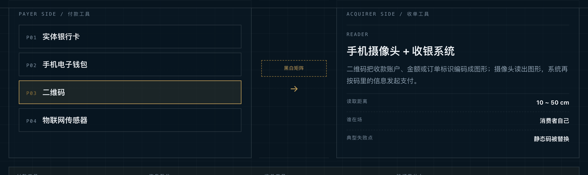
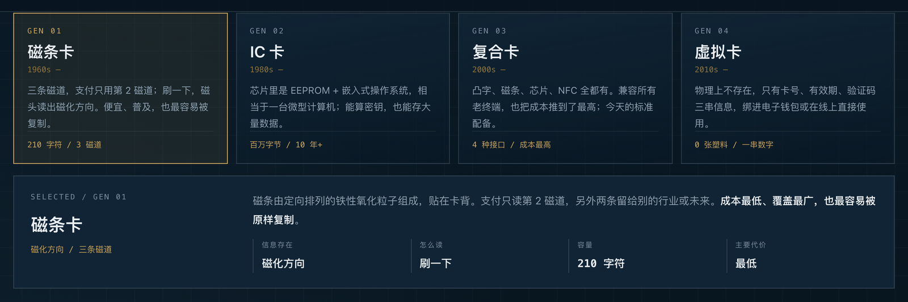
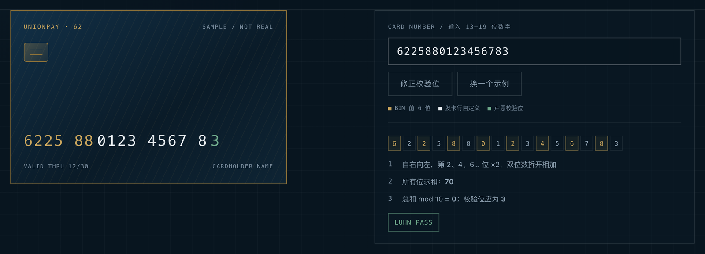
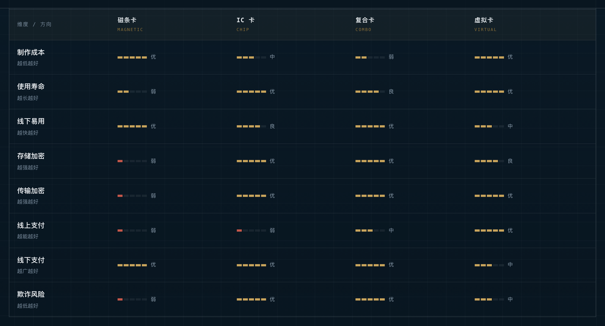
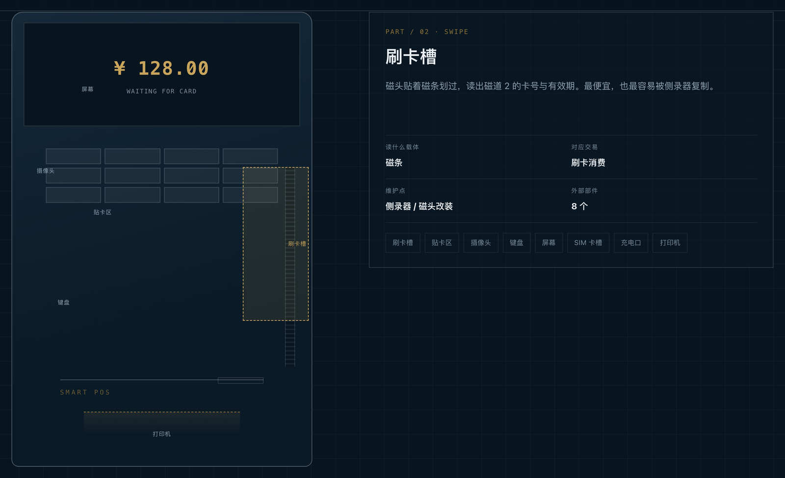
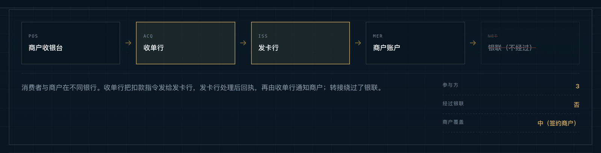
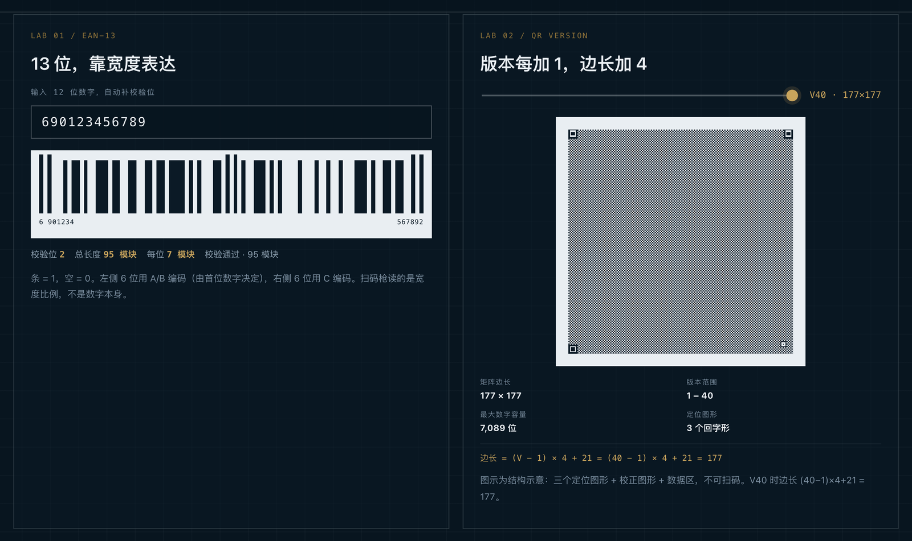
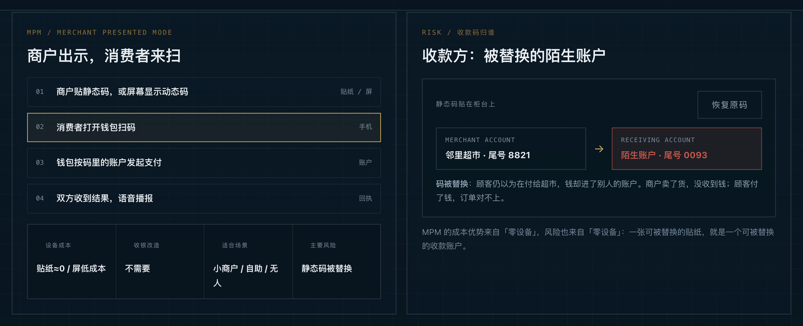
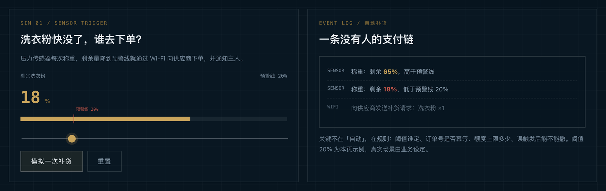

# 钱坐进工具，才走得动：支付工具的成对法则

支付工具常被当成一张清单：银行卡、扫码、NFC、可穿戴。清单记住了，问题却没答上来——为什么同一张卡刷和插的风险不一样，为什么一张贴纸能收钱也能被人换掉。这一章把工具拆成一对一对来看：左边是载体，右边是读取器，中间隔着信息的存储、读取与验证。

**关键词**: 支付工具、银行卡、磁条卡、IC 卡、卡 BIN、卢恩算法、POS、收单、直联间联、二维码、CPM、MPM、物联网支付

> **核心结论**：把第 3 章的工具箱摊开，会发现付款人手里的东西和收款人手里的东西永远成对：卡配 POS，码配摄像头，传感器配供应商系统。信息越容易被读出来，就越容易被复制；读它的机器越值钱，就越容易被动手脚。选一种支付方式，本质是选把成本和风险放在哪一头。

## 1. 付款与收单，是同一个过程的两张脸

消费者掏出卡，商户把金额敲进 POS——这不是两件事，是同一笔交易的两端。付款是资金从付款人转出去，收单是资金被收款人收进来；中间必须有一个信息载体，把「谁授权、付多少、付给谁」传过去。

所以支付工具从来不是一件，而是一对：左边是载体，右边是读取器。

| 付款工具 | 中间的信息载体 | 收单工具 | 验证靠什么 |
|---|---|---|---|
| 实体银行卡 | 磁条 / 芯片 / NFC | POS 一体机 | CVV、PIN、芯片密文、终端密钥 |
| 手机电子钱包 | 付款码 / NFC / 人脸 | 扫码枪 / 闸机 / 摄像头 | 账户登录态、令牌、生物特征 |
| 二维码 | 黑白矩阵 | 手机摄像头 | 码里的收款账户与签名 |
| 物联网传感器 | 电信号 | 供应商订单系统 | 设备身份、阈值规则、幂等订单号 |

**关键洞察**：看支付工具，不要只看付款端。载体能装什么，读取器决定怎么读；同一张卡在磁条槽和在芯片口，风险完全不是一个层级。

图上把付款端 P01–P04 与收单端摆成一条走廊，当前选中的是 P03 二维码：载体是黑白矩阵，读取器是手机摄像头加收银系统，读取距离不再「接触」，而是「对着屏幕」。

落到工程上，接入一种支付方式，第一件事不是问费率，是问三句：载体是什么、读取器是谁、验证靠什么。三句答不全，后面的对账和风控都没有落点。

## 2. 银行卡四代：信息从「磁」到「电」，再到一串数字

银行卡的物理形状七十年没怎么变，变的只是信息存放在哪里。塑料卡累计发行超过 100 亿张，载体换了四次：磁条、IC 芯片、复合卡、虚拟卡。

| 载体 | 信息存在哪 | 怎么被读 | 容量 | 主要代价 |
|---|---|---|---|---|
| 磁条卡 | 磁道上的磁化方向 | 刷一下，磁头读出 | 210 个字符 | 可原样复制 |
| IC 卡 | 芯片里的 EEPROM | 插入触点，或靠近感应 | 百万字节级 | 制卡成本高 |
| 复合卡 | 磁条 + 芯片 + NFC 全有 | 刷、插、贴都行 | 各通道各自算 | 成本与厚度最高 |
| 虚拟卡 | 只有卡号、有效期、验证码 | 绑进钱包，或线上直接填 | 三串信息 | 泄露即被盗刷 |

**容易读错的地方**：磁条的 210 是「字符」，芯片的百万是「字节」，不是同一把尺子，不能直接换算成「芯片比磁条大多少千倍」。这张表只想说明一件事：一个装不下一页文本，一个能装下一套程序。

图上 GEN 01–04 四张卡并排，当前停在磁条卡：信息存在磁道，读取方式是刷，容量 210 个字符，主要代价是可被复制。

**关键洞察**：磁条是「读出来」，芯片是「算出来」。磁条把卡号原样交出去，复制一份就能做伪卡；芯片每次生成不同的密文，终端还要验一遍。卡号可以一样，安全性不在一个层级。

工程上，这一节对应三条动作。第一，降级拦截——任何一笔本该走芯片的交易被迫退回磁条，都要拦下来并计数。第二，终端与密钥绑定，换机不换钥，换钥必换机。第三，按 BIN 加 AID 加终端能力建路由表，别让「兼容」变成「绕过」。

## 3. 卡号不是随机数：6 位说身份，1 位算出来

16 位卡号分三段：前 6 位是发卡行识别码 BIN（Bank Identification Number，现在也叫发行者识别码 IIN），中间是发卡行自定义位，最后 1 位是卢恩校验位。

卡号长度不是固定的，在 13 到 19 位之间。国内信用卡多为 16 位、借记卡 19 位；美国运通 15 位，大来卡 14 位。国内以 62、60 打头的是符合国际标准的银联标准卡，可在境外使用。

卡号第一位标识产业：1 和 2 是航空，3 是旅游娱乐，4 和 5 是银行金融，6 是商业与银行（62 就是银联），7 是石油，8 是通信，9 留给各国自分配。

卢恩算法（LUHN algorithm，也叫模 10 算法）算的是最后那一位。拿书里的例子 7992739871 手工算一遍：

| 步骤 | 做法 | 本例结果 |
|---|---|---|
| 1 | 从校验位往左，偶数位乘以 2 | 1×2=2，8×2=16，3×2=6，2×2=4，9×2=18 |
| 2 | 两位数把十位与个位相加 | 1+6=7，1+8=9 |
| 3 | 全部数字累加 | 2+7+7+9+6+7+4+9+9+7 = 67 |
| 4 | 对 10 取余 | 67 除以 10 余 7 |
| 5 | 用 10 减去余数 | 10 − 7 = 3 |

所以 7992739871 的校验位是 3，完整卡号应为 79927398713。读者的卡号敲错一位、两个相邻数字对调，这一步几乎都能发现。

**容易读错的地方**：卢恩只回答「这串数字有没有敲错」，不回答「这张卡是不是真的」。它不是加密哈希函数，防手误不防攻击。把模 10 通过当成「卡有效」，等于把门锁装在了纸门上。

还有一处细节：前 6 位能定发卡行和卡类型，但只对标准卡有效。部分非标准卡要看到 6 到 10 位才判断得出来，所以真实系统里维护的是一个可更新的卡 BIN 库，不是一个写死的规则。

图上左侧是卡面，铜金标出前三段；右侧输入框里是示例卡号，下面按卢恩步骤逐位展开，末位状态显示校验通过。改一位数字，状态立刻翻转。

工程上，卡号只做三件事：解析 BIN 定发卡行、用卢恩拦掉录入错误、其余交给发卡行授权。风控要靠 BIN 库、CVV、芯片密文、设备指纹和行为模型，不靠校验位。

## 4. 四种卡不是替代关系，是四种取舍

书里请了几位银行卡行业的老专家，按八个维度给四种卡打分：制作成本、使用寿命、线下易用、存储加密、传输加密、线上支付、线下支付、欺诈风险，每项满分 10 分。

原表是图片，我们按结论做了定性对照：成本与欺诈风险越低越好，其余越高越好。

图上是八行四列的对照表，列头是磁条卡、IC 卡、复合卡、虚拟卡，每格用五点标记强度。磁条在成本与线下易用上满分，在存储与传输加密上垫底；虚拟卡反过来，线上与发行效率领先，线下与欺诈风险吃亏。

**关键洞察**：复合卡不是「更先进」，是「都兼容」。它把四种接口叠在一张卡上，换来所有终端都能受理，付出的是成本与厚度。虚拟卡是另一头：放弃物理接口，换取发行效率和线上覆盖。

表里最该被记住的不是分数，是方向。成本、欺诈风险这两项是「越低越好」，很多人看表时会把它们当成「越高越好」，结论就整个反了。

工程上，这张表是路由表和风控策略的依据：老终端只认磁条，就用最弱的一环决定策略；虚拟卡按用途给一次性额度，别让一张卡在所有商户通用。

## 5. POS 一体机：外面八个部件，里面三样东西

收单端的进化路径很清晰：固定专线刷卡机，到 Wi-Fi / 4G 的智能 POS，再到把刷卡、插卡、贴卡、扫码集成在一起的一体机。一体机通常两块屏，一块给顾客确认金额，一块给店员操作。

拆开看，外部是八个部件：刷卡槽、贴卡区、摄像头、键盘、屏幕、SIM 卡槽、充电接口、打印机。打开后盖，内部只有三样：电池、NFC 天线、各种电路。

图上是一台 POS 的示意，右侧六个热区可以逐个点开，当前停在「刷卡槽」：它读的是磁条，对应交易是刷卡消费，维护点是防侧录与防拆。

**关键洞察**：一台 POS 的部件清单，就是一张可被攻击面清单。刷卡槽对应侧录，键盘对应窥探与改装，摄像头对应扫码替换，SIM 与网络对应信号劫持。收单安全不是一句抽象的话，它落在每一个能被接触的零件上。

工程上至少三条：终端序列号与密钥一一绑定；开机自检加防拆告警，拆机即失效；固件签名校验，拒绝来源不明的升级包。

## 6. 中国收单：直联与间联，看报文第一站落到谁家

中国收单的路径，要看历史。1985 年 3 月，中国银行珠海分行发行了国内第一张人民币信用卡；1987 年中国银行加入 VISA 与 MasterCard，之后各家银行陆续发行符合国际标准的卡。2002 年中国银联成立，收单市场先是银联一家主导。

随后商业银行开始自己做：持卡人与商户在同一家银行，收单行直接转账，不必把报文送去银联；跨行时，收单行把扣款指令发给发卡行，回执再沿原路回来——两条路径都绕过了银联。2010 年前后第三方支付机构加入，市场进一步分化。

| 模式 | 报文第一站 | 跨行时经过谁 | 特点 |
|---|---|---|---|
| 银联主导 | 银联商务 | 银联主机判断后转接 | 覆盖最广，环节最多 |
| 直联 | 银联主机 | 银联 → 发卡行 | 数据先到银联，原路返回 |
| 间联 | 收单行主机 | 收单行 → 发卡行 | 非跨行时可以不经过银联 |
| 第三方收单 | 支付机构 | 支付机构再对接银行 | 接入快，多一层机构 |

图上这条链路停在「跨银行转接」：消费者与商户在不同银行，收单行把扣款指令发给发卡行，处理后回执，再由收单行通知商户——转接绕过了银联，但记账责任没少一层。

**关键洞察**：绕过银联不等于绕过清算。减少的是转接环节，不是记账责任。参与方越少，到账越快；差错定位和对手方风险也越集中。

工程上盯两件事：一是报文第一站落到谁家，决定了日志在哪查、差错在哪定位；二是结算对手方集中度，越集中越要设上限。

## 7. 码的容量：一维装 13 位，二维装 7000 多位

一维条形码用宽度表达信息：条代表 1，空代表 0，每 7 个模块表示 1 个字符。以最常见的 EAN-13 为例，整条码是 95 个模块，装 13 位数字——12 位数据加 1 位校验，校验位由前 12 位算出来。

二维码换了一套思路。QR 码（Quick Response Code）是正方形矩阵，一共 40 个版本，版本 1 是 21×21，版本每加 1、边长加 4：

边长 =（V − 1）× 4 + 21

V 取 40 时，边长是（40 − 1）× 4 + 21 = 177，也就是 177×177 矩阵。

| 指标 | EAN-13 一维码 | QR 码 V40 |
|---|---|---|
| 形状 | 95 个模块的条空序列 | 177×177 正方形矩阵 |
| 典型容量 | 13 位数字 | 数字模式 7,089 位；字节模式约 2,953 字节 |
| 能否装下订单信息 | 不能 | 能，连同金额、时效、签名一起装 |
| 读取方式 | 激光扫描器，需对准 | 摄像头，任意角度 |

**容易读错的地方**：7,089 是数字模式的上限，不是「随便装 7,089 个汉字」。字节模式约 2,953 字节，换成中文要按编码折算。书里概括为「7,000 多个字符」，指的是最大数字容量。两边容量差约 545 倍，接近三个数量级。

图上左边是可编辑的 EAN-13，输入 12 位数字后自动补校验位并实时生成条码；右边把 QR 版本推到 V40，矩阵边长 177×177，旁边一行公式显示推导过程。

**关键洞察**：一维码只能当「索引」，二维码才能当「凭证」。13 位数字够标识一个商品，装不下订单号、金额、签名与时效；二维码能把这些一起放进去，才撑得起「扫一下就付款」。

工程上，这也是「静态码」与「动态码」的分界线：动态码把订单号、金额、有效期、签名一起编码进去，每次刷新；静态码只有收款账户，安全全靠「这张纸有没有被换」。

## 8. 谁扫谁：CPM 与 MPM，差的是成本与风险

扫码支付按「谁出示、谁扫」分两种。CPM 是消费者出示付款码，商户扫；MPM 是商户出示收款码，消费者扫。

| 维度 | CPM · 商户主扫 | MPM · 消费者主扫 |
|---|---|---|
| 设备成本 | 扫码枪，或改造收银系统 | 一张贴纸，或一块展示屏 |
| 收银改造 | 必须 | 几乎为零 |
| 适合场景 | 超市、便利店等有店员的柜台 | 自动贩卖机、食堂、自助加油、O2O |
| 主要风险 | 排队、设备故障、改造投入 | 静态码被替换、钓鱼码 |
| 市场分布 | 日本以 CPM 为主 | 中国 CPM 与 MPM 平分 |

**关键洞察**：CPM 把成本放在商户，MPM 把风险放在码上。选择哪一种不是技术优劣，而是「谁承担改造、谁承担替换」。

MPM 的优势来自零设备，风险也来自零设备：一张可以随手贴上的纸，就是一笔可以随手换掉的收款账户。

图上停在 MPM 模式，点「模拟被替换」后，左侧商户账户仍是邻里超市尾号 8821，右侧收款账户已经变成别人的：顾客以为在付给超市，钱却进了另一张码。商户卖了货没收到钱，顾客付了钱订单对不上。

工程上，MPM 至少配三道：优先动态码；收款方实名加语音播报，播报金额与订单一致才算成功；码与门店、终端绑定，收款方变更强制提醒。静态码还要加防拆封装和巡检。

## 9. 把工具翻译成风险清单

把这一章摊平，风险可以按四层排：载体、读取器、网络、账户。同一笔风险换个工具不会消失，只会换一层发生。

| 层级 | 敞口公式 | 这一层出问题是什么样 |
|---|---|---|
| 载体 | 复制成本 × 可复制次数 | 磁条被侧录复制，写成空白卡变伪卡 |
| 读取器 | 被控终端数 × 单笔限额 | POS 被改装、密钥被导出、固件被替换 |
| 网络 | 暴露时长 × 笔数 | 静态码被换、钓鱼码把人引到假页面 |
| 账户 | 误触发概率 × 金额 × 频次 | 传感器阈值漂移、重复下单、钱包被盗 |

图上左侧滑杆把剩余洗衣粉降到预警线以下，右侧事件日志按时间顺序记录「触发 → 校验 → 下单 → 扣款 → 通知」，每条都带订单号；预警线 20% 是本页示例，真实场景由业务设定。

八种工具按这四层排下来，就是一张可以拿去巡检的清单：磁条卡盯侧录与降级，IC 卡盯降级与中继，复合卡盯路由与 AID 配置，虚拟卡盯令牌与首绑，卡号规则盯 BIN 库与误信，POS 盯改装与二清，二维码盯替换与钓鱼，物联网盯误触发与幂等。

### 三条铁律

1. **载体决定可复制性。** 信息原样交出去，就能被原样复制；每次能算新密文，复制成本才上来。判断一种工具安不安全，先问它「读出来」还是「算出来」。
2. **读取器决定攻击面。** 谁读数据，谁就是下一个要被攻破的边界。POS、扫码枪、摄像头、供应商系统，都要算进风险预算。
3. **越便宜的载体，越要验归属。** 一张贴纸成本近零，替换它也近零。低成本收单必须配实名、动态码与播报；无人的支付必须有幂等、额度与复核三道闸。

### 四个自测问题

1. 为什么说磁条卡与 IC 卡不是一个安全层级？「读出来」和「算出来」分别意味着什么？
2. 卡号前 6 位与最后 1 位各是什么？卢恩算法能防攻击吗？
3. CPM 与 MPM 各自把成本放在谁身上、把风险放在谁身上？
4. QR 码 V40 的矩阵边长怎么算？为什么一维码当不了支付凭证？

## 画图建议

**一句话 prompt**：一张「支付科技、理性、精算」气质的工具配对图，深墨蓝底、极细 34px 网格、等宽字标注；画面左侧是一排卡片与二维码，右侧是一排读取器，中间用一根铜金细线做「载体 → 读取器」的连接，线上标三段信息「谁授权 / 付多少 / 付给谁」；左下角一枚被撕开一角的贴纸二维码，暗示「可替换的载体」；整体克制，无人物、无卡通、无长段中文。

**分项拆解**：

- 场景：一张俯视的工具台，不是流程图；重点是「左右成对」与「中间那段信息如何被读」。
- 量级：图上只出现两个数字——磁条 210 个字符、QR V40 177×177；不要出现 7,089 与 2,953 两组容量，避免读者把数字模式与字节模式混读。
- 主体元素：四张卡（磁条 / 芯片 / 复合 / 虚拟）、一个黑白二维码、一台 POS 一体机轮廓、一条被撕开一角的静态码贴纸、三枚信息锚点。
- 构图：横向 16:9；公众号封面主体放中间安全区，左右各留 8%；标题区不压工具台中心。
- 色板：深墨蓝底、冷白线；铜金只给连接线与三枚锚点；被替换的贴纸用暗红细虚线描边。
- 文字量：图上中文短标签不超过 6 处（载体、读取器、谁授权、付多少、付给谁、可替换），其余靠位置与编号。
- 传达理念：支付工具的秩序感，来自「每一种载体都有一个对应的读取器」，而不是来自名词背得全。

## 参考资源

- 原书：陈斌《一本书读懂支付》第 3 章「支付的基础工具」
- 豆瓣条目：https://book.douban.com/subject/36422205/
- 可视化页面（含工具配对、四代卡切换、卡号与卢恩实时校验、八维打分表、POS 部件热区、收单路径切换、EAN-13 与 QR 版本滑杆、CPM/MPM 与码替换模拟、物联网补货）：https://baixiaoustc.github.io/notes/payment-primer/ch03/
