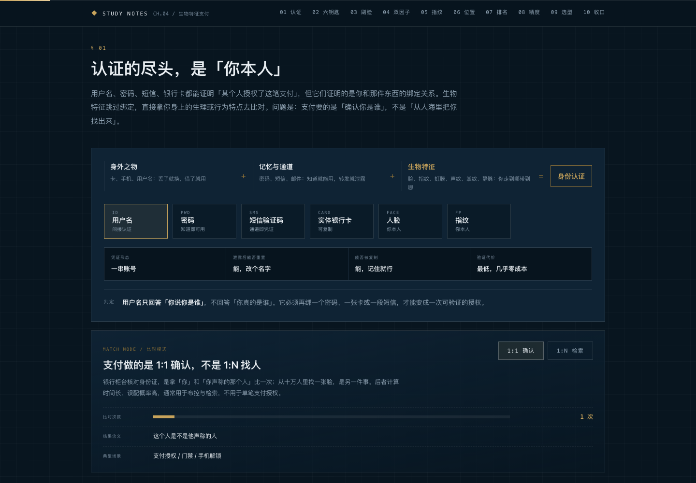
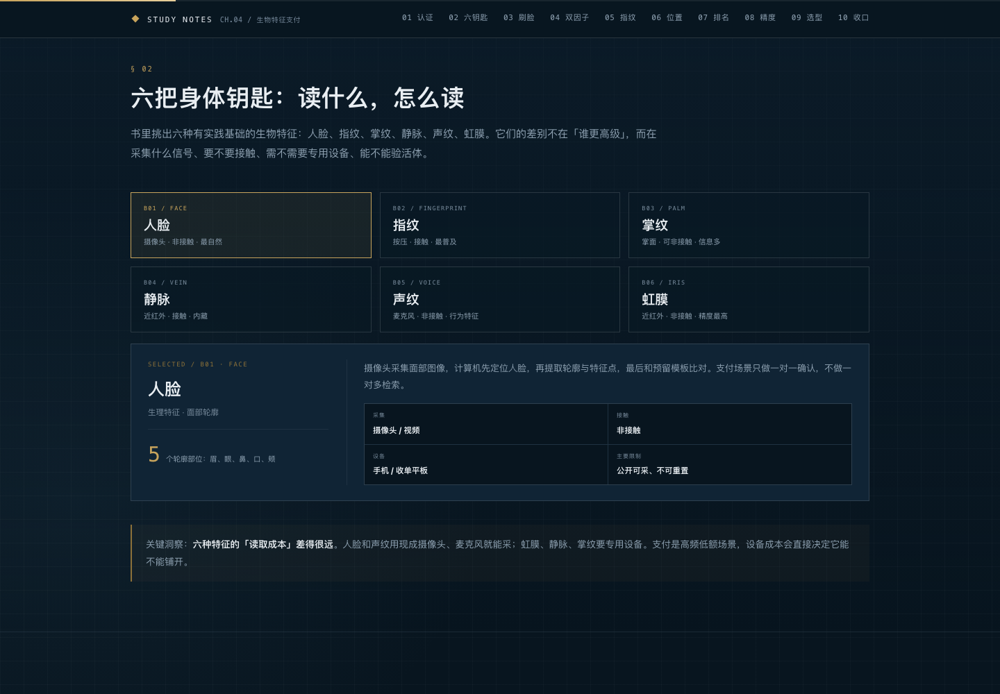
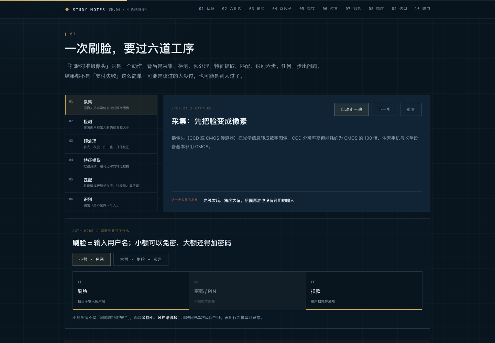
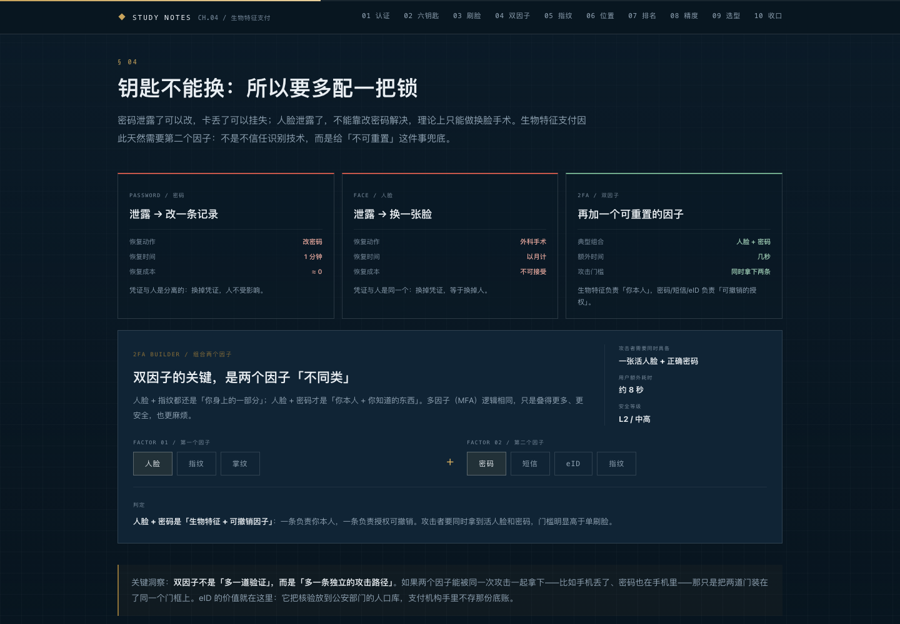
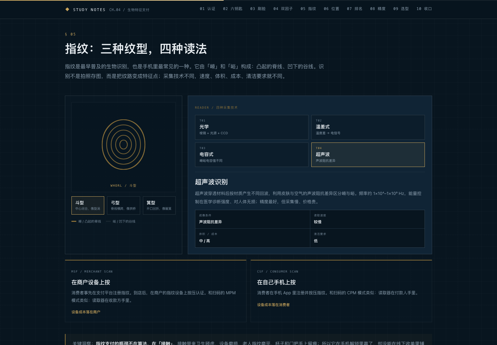
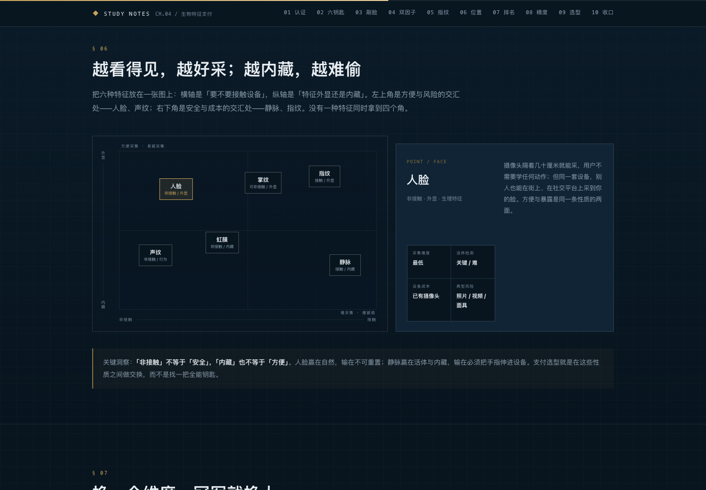
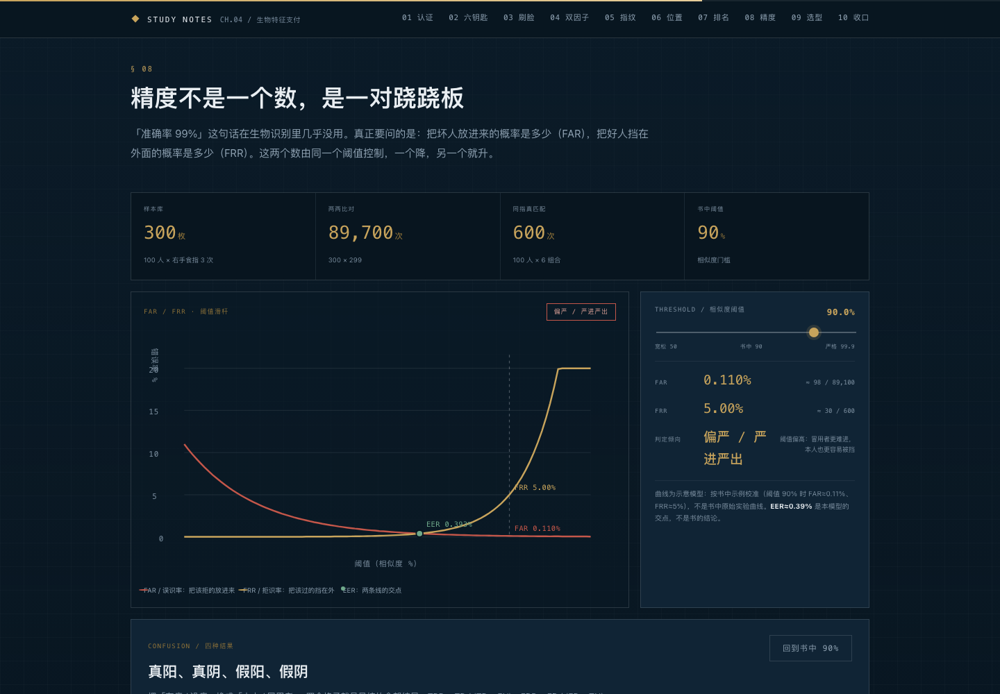
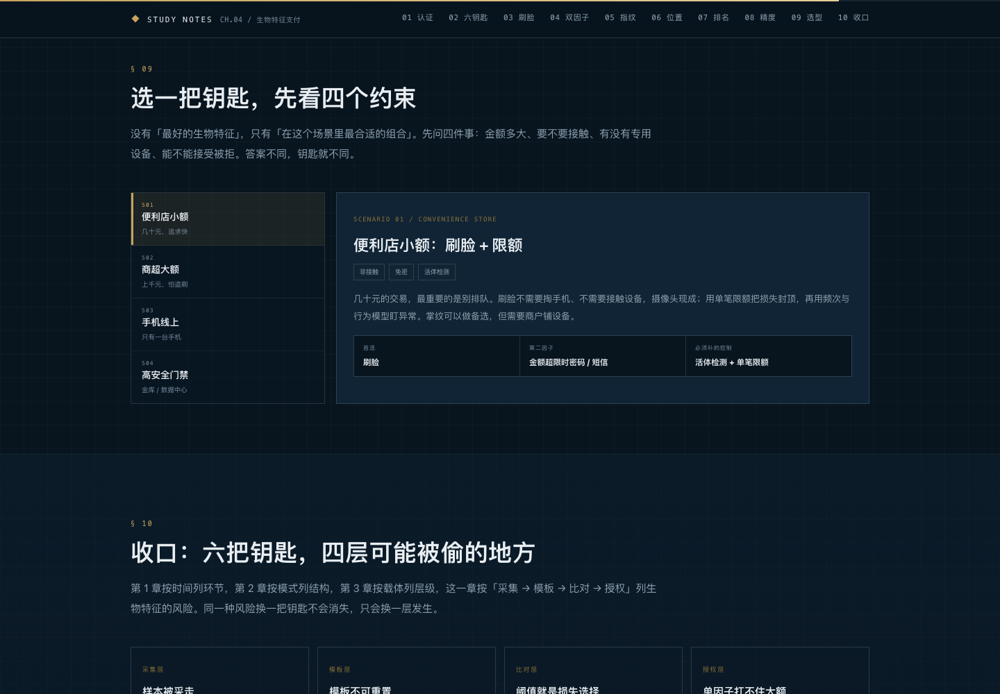

# 身体就是钥匙，但这把钥匙不能换：生物特征支付的四道门

刷脸、按指纹，已经是今天最顺手的两个支付动作：不用掏卡，也不用记密码。但在支付系统里，这不是「更安全的密码」，而是「另一类凭证」——省掉了携带与记忆，也把「泄露之后改不了」写进了前提。这一章把六种生物特征、刷脸六步、双因子、FAR/FRR 摆在一起，只回答一个问题：认错人之后，我们靠什么兜底。

**关键词**: 生物特征支付、人脸识别、指纹、双因子、FAR、FRR、EER、活体检测、模板、1:1 确认

## 1. 先把三种凭证分清楚

支付一直在回答一个问题：这笔钱，是不是本人授权的？过去我们靠三样东西间接证明：你带的（卡、手机、用户名）、你知道的（密码、短信码）、你身上的（脸、指纹、虹膜、声纹）。

前两类都靠一条「绑定关系」——东西在你手里，或者密码只有你知道，所以能推断是你。第三类跳过绑定，直接拿你本人的生理或行为特征去比对。

| 凭证类型 | 要不要随身带 | 丢了 / 忘了 | 泄露后能否重置 | 典型风险 |
|---|---|---|---|---|
| 卡、手机、用户名 | 要 | 换一张、换一台 | 能，改一条绑定 | 被复制、被借用 |
| 密码、短信码、邮件 | 不用带，但要设备 | 忘、猜、转发 | 能，改密码 | 被猜到、被转发 |
| 脸、指纹、虹膜、声纹 | 不用带 | 不会丢 | 不能（脸只能换脸） | 被采走、不可撤销 |

这张表只说明一件事：第三类把「间接认证」变成了「直接认证」，代价是不可重置。密码泄露，改一条记录；人脸泄露，只能做换脸手术。

还有一个容易混的地方：支付做的是 **1:1 确认**，不是 **1:N 检索**。柜台核对身份证，是拿「你」和「你声称的那个人」比一次；从十万人里找一张脸，是另一件事——计算时间长、误配概率高，用于布控与检索，不用于单笔授权。

图上上半部分把卡、密码、短信和脸、指纹并排摆开，下半部分用一次比对演示 1:1 与 1:N 的区别：前者比对 1 次，回答「这个人是不是他声称的人」；后者要在库里找最像的一张，回答「这是谁」。

**关键洞察**：支付要的是确定性，不是「最像」。我们做授权链路时，接口里就不该出现「按姓名加人脸检索」这种能力——那是布控，不是支付。

## 2. 六把钥匙：先看读取成本

书里挑了六种有实践基础的生物特征：人脸、指纹、掌纹、静脉、声纹、虹膜。它们的差别不在「谁更高级」，而在读什么信号、要不要接触、需不需要专用设备、能不能验活体。

| 特征 | 读什么 | 接触 | 需要什么设备 | 书里评价 |
|---|---|---|---|---|
| 人脸 | 眉、眼、鼻、口、颊的轮廓与特征点 | 非接触 | 现成摄像头 | 总分第 1 |
| 掌纹 | 主线、皱纹、脊末梢、分叉点 | 可非接触 | 要商户铺设备 | 总分第 2 |
| 虹膜 | 近红外下的虹膜纹理编码 | 非接触 | 专用相机，强光与隐形眼镜会干扰 | 精度最高、设备贵 |
| 静脉 | 近红外下的血管图 | 接触 | 专用设备 | 活体、内藏 |
| 声纹 | 声道结构与说话习惯 | 非接触 | 麦克风 | 设备简单、噪声敏感 |
| 指纹 | 嵴与峪形成的特征点 | 接触 | 指纹模块 | 总分最低 |

书里的结论很明确：刷脸优于其他五种，因为它最自然、不用接触设备；掌纹紧随其后，差在接受度与便利性；指纹总分最低，致命问题是必须物理接触识别仪。

图上六张卡从 B01 到 B06 排开，每张标出采集方式、是否接触、用什么设备；当前选中的是人脸卡，标注眉、眼、鼻、口、颊五个轮廓部位。

**关键洞察**：支付是高频低额场景，设备成本会直接决定一种方式能不能铺开。技术排名低，不等于技术差——指纹在手机解锁里赢，是因为设备本来就在手里；线下收单要额外铺设备，动力就不足。

## 3. 一次刷脸，要过六道工序

「把脸对准摄像头」只是一个动作，背后是六步：采集、检测、预处理、特征提取、匹配、识别。

| 步 | 做什么 | 这一步失败会怎样 |
|---|---|---|
| 01 采集 | 摄像头把光学信息变成数字图像 | 光太暗、角度太偏，后面再准也没有输入 |
| 02 检测 | 在画面里框出人脸的位置与大小 | 多人、侧脸、遮挡，框错位置 |
| 03 预处理 | 补光、灰度变换、归一化、几何校正 | 光照不均，特征整体漂移 |
| 04 特征提取 | 把脸变成一组可比对的特征数据 | 分辨率不够，特征根本提不出来 |
| 05 匹配 | 与预留模板算相似度，过阈值才算匹配 | 阈值定生死 |
| 06 识别 | 输出「是不是同一个人」 | 结论交给业务，钱从这里出去 |

图上是一条六步进度条，当前停在第一步采集：摄像头用 CMOS 传感器把光学信息转成数字图像，右侧注明「这一步失败会怎样」——光线太暗、角度太偏，后面再准也没有可用的输入。

**关键洞察**：六步里只有第五步在「比对」，前四步都在「把脸变成可比的东西」。绝大多数现场失败，不是算法不认识你，而是光、角度、遮挡、分辨率让输入根本不合格。

落到工程上，采集失败和比对失败要分开打点：曝光不足、遮挡、角度异常各自计数，否则我们会误以为「算法不行」，实际是门口那盏灯不行。

## 4. 刷脸到底顶了什么：小额免密，大额双因子

书里有一个很好的比喻：刷脸只相当于输入了用户名，还必须输入密码才能完成认证。

这句话决定了整个分层。小额交易用刷脸加单笔限额，把单次损失封顶；大额交易必须再加一条可撤销的因子——密码、短信或 eID。

| 组合 | 攻击者要同时具备 | 用户多花的动作 |
|---|---|---|
| 人脸 + 密码 | 一张活人脸 + 正确密码 | 输一次密码 |
| 人脸 + 短信 | 一张活人脸 + 手机与验证码 | 等一条短信 |
| 人脸 + eID | 一张活人脸 + 公安人口库核验 | 一次授权调用 |
| 人脸 + 指纹（书里也列为双因子） | 一张活人脸 + 一枚活指纹 | 再按一次 |

图上把密码、人脸、双因子三块并排对比：密码泄露只需改一条记录，人脸泄露等于换一张脸；组合器默认选定「人脸 + 密码」，写明攻击者需要同时拿到一张活人脸和正确密码。

**关键洞察**：双因子不是「多一道验证」，而是「多一条独立的攻击路径」。书里把「刷脸 + 指纹」也算作双因子组合，但从「能不能重置」的角度看，两个因子都长在身上：一次攻击（比如把人控制住）可能同时拿下。所以真正稳的组合，是一条生物因子加一条可撤销因子。eID 的价值也在这里：核验放在公安部门的人口库，支付机构手里不存那份底账。

## 5. 指纹：三种纹型，四种读法

指纹由「嵴」（凸起的脊线）和「峪」（凹下的谷线）构成，纹型分三类：斗型像旋涡，弓型像拱桥，箕型像簸箕。

采集技术有四代，各有用武之地：

| 技术 | 原理 | 速度 | 体积 / 成本 | 主要弱点 |
|---|---|---|---|---|
| 光学 | 棱镜加光源，把脊峪投到 CCD | 一般 | 大 / 低 | 指纹膜可骗过 |
| 温差式 | 脊峪与传感器的温度差转电信号 | 慢 | 小 | 受环境温度影响 |
| 电容式 | 脊与峪的电容值不同 | 快 | 小 | 干湿手指不稳定 |
| 超声波 | 声波在脊峪处的阻抗不同 | 快 | 中 | 成本高 |

还要分两种模式：读取器在商户手里（MSF，设备成本落在商户），还是在消费者自己手机上（CSF，设备成本落在消费者）。

图上把三种纹型、四种采集技术和两种按压模式放在一起：同一种技术，读取器在商户手里还是在消费者手里，设备成本落在谁头上，决定了它能不能铺开。

**关键洞察**：指纹的瓶颈不在算法，在「接触」。接触带来卫生顾虑、设备磨损、老人指纹磨平，手指每天接触大量物品还留下痕迹。它在手机解锁里赢了，却没能在线下收单里铺开——技术排名低，不等于技术差。

## 6. 越看得见，越好采；越内藏，越难偷

把六种特征放进一张二维图：横轴是「要不要接触设备」，纵轴是「外显还是内藏」。

| 位置 | 特征 | 好处 | 代价 |
|---|---|---|---|
| 非接触 + 外显 | 人脸、声纹 | 最自然，设备现成 | 最好采，也最难防 |
| 接触 + 外显 | 指纹、掌纹 | 信息多，精度稳 | 卫生顾虑，留痕 |
| 非接触 + 内藏 | 虹膜 | 认假率可到 1/1,500,000 | 设备贵，强光与隐形眼镜会失败 |
| 接触 + 内藏 | 静脉 | 可验活体，难偷 | 必须把手指伸进设备 |

图上六个点分布在四个角之间：人脸与声纹落在「非接触 / 外显」这一侧，静脉与指纹落在「内藏 / 接触」一侧；页面两端标着「方便采集 · 易被采集」和「难采集 · 难被偷」。

**关键洞察**：「非接触」不等于安全，「内藏」也不等于方便。没有一把全能钥匙，选型就是在这些性质之间做交换。

## 7. 精度不是一个数：FAR 和 FRR 是一对跷跷板

「准确率 99%」这句话在生物识别里几乎没用。真正要问的是两个数：把坏人放进来的概率（FAR，False Acceptance Rate，误识率），和把好人挡在外面的概率（FRR，False Rejection Rate，拒识率）。

书里给了一个能自己复算的实验。100 个人，每人右手食指采 3 次，共 300 枚指纹；每枚与除自己外的所有样本比对一次，总次数是 300 × 299 = 89,700 次。其中「同一个人同一根手指」的组合是 100 × 6 = 600 次——三次采样两两配对，正反各算一次。剩下的 89,700 − 600 = 89,100 次，是类间比对。

阈值定在相似度 90% 时，把本应失败误判为成功 100 次，FAR = 100 / 89,100 = 0.11%；把本应成功误判为失败 30 次，FRR = 30 / 600 = 5%。

| 结果 | 含义 | 业务上是什么 |
|---|---|---|
| 真阳 TP | 本人，判定本人 | 正常放行 |
| 假阳 FP | 冒用者，判定本人 | 资金损失（FAR 管这个） |
| 假阴 FN | 本人，判定冒用者 | 体验损失（FRR 管这个） |
| 真阴 TN | 冒用者，判定冒用者 | 正常拦截 |

公式一行：FAR = 误判成功次数 / 类间比对次数；FRR = 误判失败次数 / 同指比对次数；TPR = TP / (TP + FN)；FPR = FP / (FP + TN)。

图上滑杆停在阈值 90%：左侧 FAR 0.11%（100 / 89,100），右侧 FRR 5.00%（30 / 600），两条线在中间相交处标着 EER。向右拖阈值，钱更安全、人更难进；向左拖，反过来。

**关键洞察**：调阈值不是「提高精度」，而是「选择把损失放在哪一边」。EER 只是两条曲线的交点，它告诉你算法在哪里最平衡，不告诉你该用哪个点——那要由单笔金额、赔付能力和用户体验共同决定。

**容易读错的三处**：

1. 「准确率 99%」没有信息量，必须拆成 FAR 和 FRR 两个方向。
2. 89,700 是**有方向**的比对次数（每个样本与除自己外所有样本各比一次），不是 44,850 组无序配对——书里是按前者算的。
3. 站点上的 EER 约 0.39%，是按书中示例校准的**示意模型交点**，不是书的原始实验结论。

## 8. 算一笔钱：阈值到底值多少钱

把上面的比例放进业务，假设我们每月有 10 万笔刷脸支付、单笔均价 300 元，月流水就是 3,000 万元。这是元级的业务流水账，和上一节 300 枚样本的算法评测不是同一个口径，不能相乘。

按 FAR 0.11% 算，每月约 110 笔冒用被放进来的交易，按 300 元一笔计，损失约 3.3 万元。

把阈值调严，FAR 压到 0.01%，冒用降到约 10 笔，损失 3,000 元——省下约 3 万元。

代价在另一边：FRR 5% 意味着 5,000 笔真人被挡在门外。每提高 1 个百分点，就多 1,000 位真人/月被拒；按每位一次人工客服 5 元计，就是 5,000 元/月，还没算流失。

**关键洞察**：省下的 3 万元赔付，可能刚好被客服和流失吃掉。所以更有效的做法不是死调阈值，而是金额分层——小额免密加单笔限额，把单次损失封顶；大额强制第二条因子，让不可撤销的因子只负责「你是你」。

## 9. 选一把钥匙，先看四个约束

没有「最好的生物特征」，只有「在这个场景里最合适的组合」。先问四件事：金额多大、要不要接触、有没有专用设备、能不能接受被拒。

| 场景 | 金额 | 约束 | 推荐组合 |
|---|---|---|---|
| 便利店 | 几十元 | 要快、别排队 | 刷脸 + 单笔限额 + 活体检测 |
| 商超 | 上千元 | 怕盗刷 | 刷脸 + 密码 / 短信，或直接走卡 |
| 手机线上 | 不等 | 只有一台手机 | 指纹或人脸 + 设备绑定 |
| 金库门禁 | 不计金额 | 要活体、不可复制 | 静脉或虹膜，设备由我们控制 |

图上四张场景卡 S01 到 S04 摆在一起，默认选中便利店小额：非接触、免密、活体检测，金额超限时补密码或短信。

**关键洞察**：选型不是找最强的那把钥匙，而是找在这个金额、这个设备条件、这个拒绝容忍度下最不坏的那把。

### 把风险摊成四层

第 1 章按时间列环节，第 2 章按模式列结构，第 3 章按载体列层级，这一章按「采集 → 模板 → 比对 → 授权」列风险。同一种风险换一把钥匙不会消失，只会换一层发生。

| 层 | 敞口口径 | 出事的样子 | 我们盯什么 |
|---|---|---|---|
| 采集 | 可获取样本数 × 合成质量 | 街上采脸、杯子上取指纹、短视频里录声纹 | 活体检测、随机动作挑战 |
| 模板 | 模板条数 × 跨场景复用度 | 泄露一次，十年都用同一条模板 | 不可逆存储、加盐、按场景隔离、令牌化 |
| 比对 | 阈值 × FAR / FRR | 调严挡真人，调松放冒用 | 按金额分档的阈值 |
| 授权 | 单笔限额 × 是否双因子 | 单因子直接签大额 | 金额分层、二次确认 |

八条巡检压缩成一句：人脸盯活体与限额，指纹盯接触与设备归属，声纹只做辅助，虹膜与静脉只放在设备可控的场景；模板防复用，活体要版本化，大额必须双因子，采集要单独同意、最小留存。

### 三条铁律

1. **不可重置的因子，不能单独签大额。** 脸只能换脸，模板泄露改不了；大额必须由可撤销的第二条路径来锁。
2. **先问采集是不是接触，再问算法准不准。** 接触决定卫生、磨损、老人可用性，也决定设备成本落在谁头上。
3. **阈值是把损失放在哪一边，模板是不可逆，活体是持续攻防。** 三者都是业务决策，不是一次验收。

### 四个自测问题

1. 1:1 和 1:N 各回答什么问题？支付为什么只用前者？
2. 刷脸为什么只相当于「输入用户名」？小额免密的兜底靠什么？
3. 300 枚样本、89,700 次比对、600 次同指匹配——FAR 0.11% 与 FRR 5% 分别用哪个分母算出来？
4. 指纹技术最成熟，为什么在书里六种方式中总分最低？

## 画图建议

**一句话 prompt**：一张「支付科技、理性、精算」气质的封面图，深墨蓝底、极细 34px 网格、等宽字标注；画面中央是一枚悬浮的指纹/人脸轮廓构成的钥匙齿形，钥匙柄上有一道断开并被铜金细线重新缝合的缺口，暗示「钥匙在身上，但断了一次就接不回去」；背景隐约是一排细小的比对刻度线与一条 FAR/FRR 交叉曲线，无人物、无卡通、无长段中文。

**分项拆解**：

- 场景：深色实验室台面，一件被放大的「身体钥匙」静物，不是流程图。
- 量级：图上只出现两个数字——阈值 90%、FAR 0.11%；不要同时出现 1/1,500,000 与 0.00008%，避免混读不同口径。
- 主体元素：钥匙齿形（指纹纹路）、人脸轮廓的虚线、缝合的缺口、交叉的两条曲线、四枚小节点（采集 / 模板 / 比对 / 授权）。
- 构图：横向 16:9；主体放中间安全区，左右各留 8%；标题区不压钥匙中心。
- 色板：深墨蓝底、冷白线；铜金只给缺口缝合线与两个数字；比对层用暗红细虚线。
- 文字量：图上中文短标签不超过 6 处（采集、模板、比对、授权、阈值、不可重置），其余靠位置与编号。
- 传达理念：生物特征的秩序感来自「直接」，风险也来自「直接」——越不用带，越不能换。

## 参考资源

- 原书：陈斌《一本书读懂支付》第 4 章「生物特征支付」
- 豆瓣条目：https://book.douban.com/subject/36422205/
- 可视化页面（含三类凭证与 1:1 确认、六把钥匙切换、刷脸六步单步播放、双因子组合器、指纹三型四读、六特征位置图、FAR/FRR 阈值滑杆、选型四场景）：https://baixiaoustc.github.io/notes/payment-primer/ch04/
