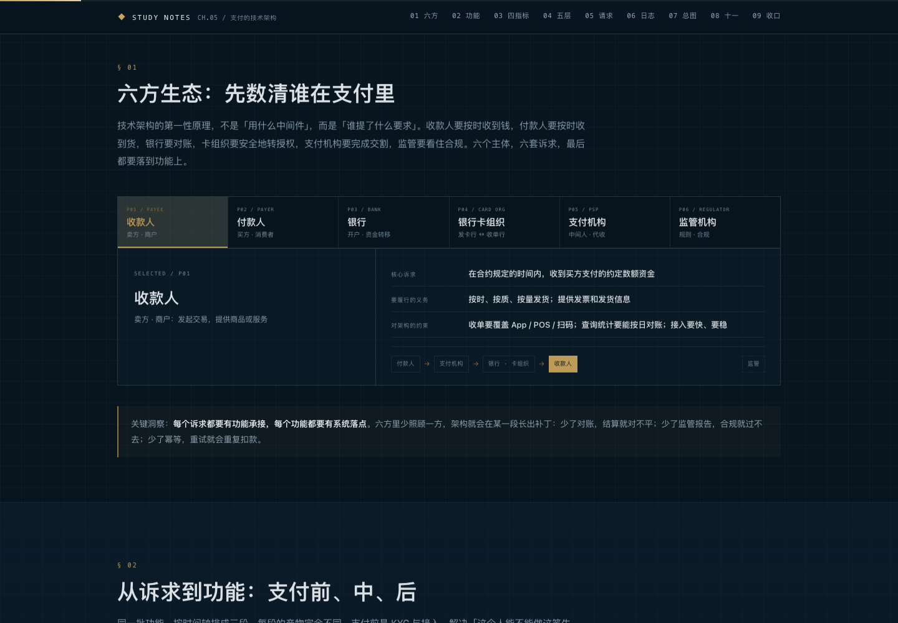
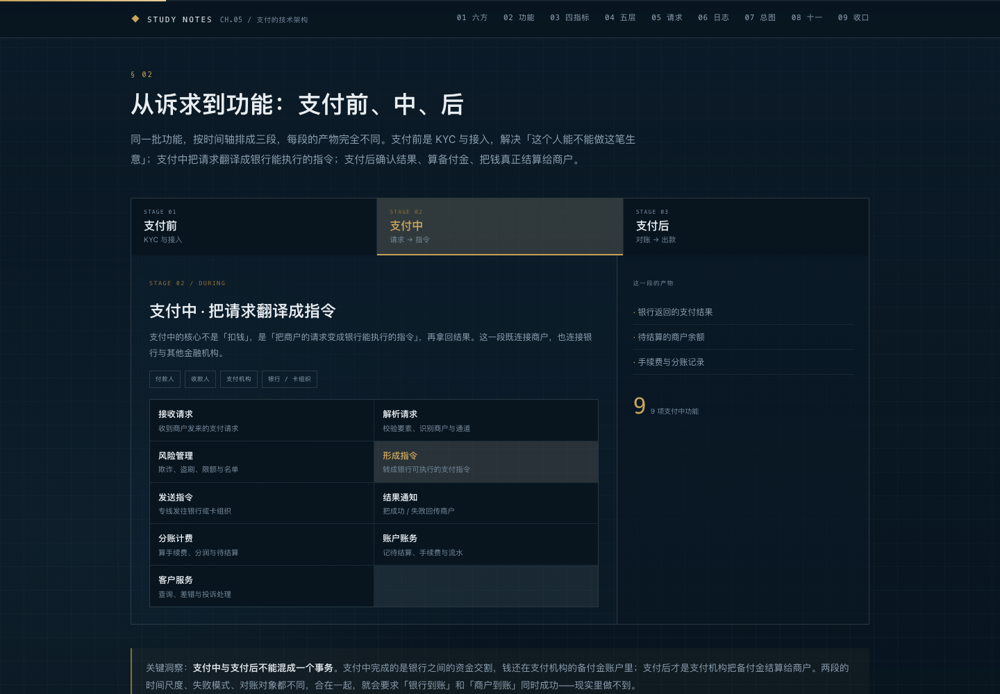
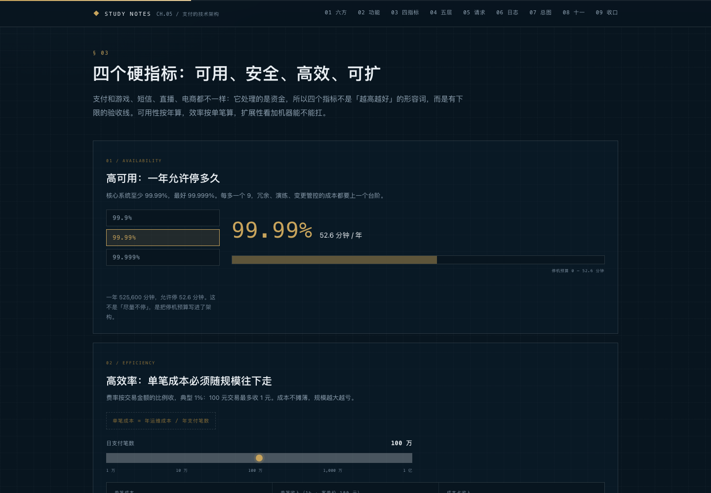
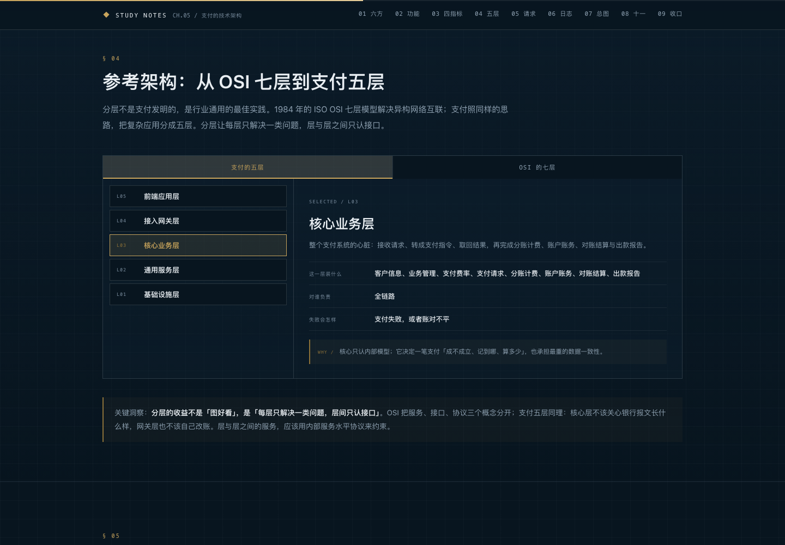
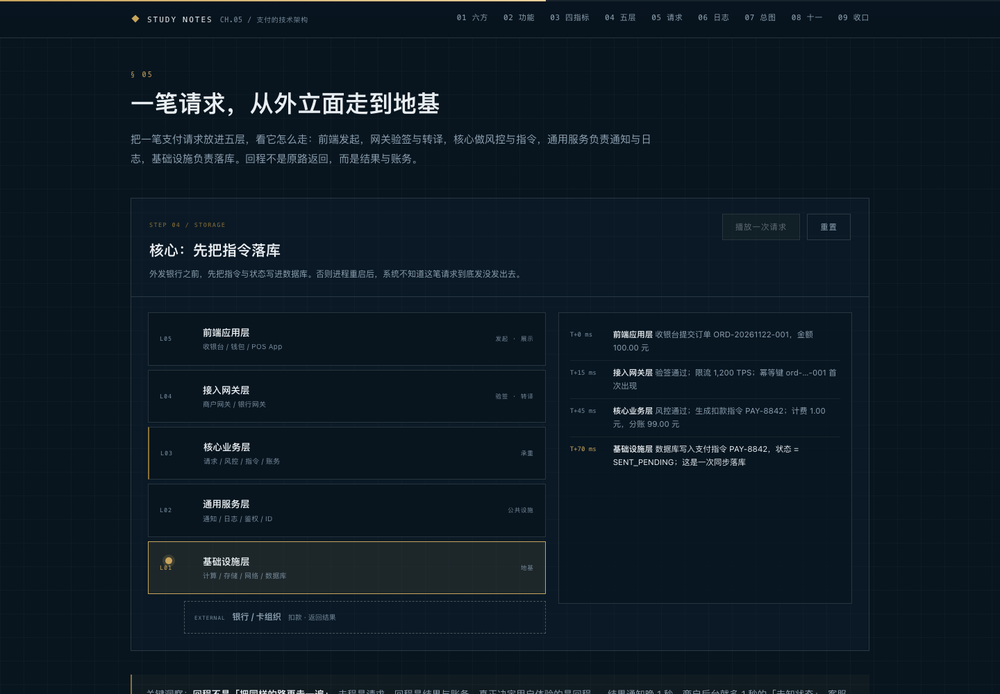
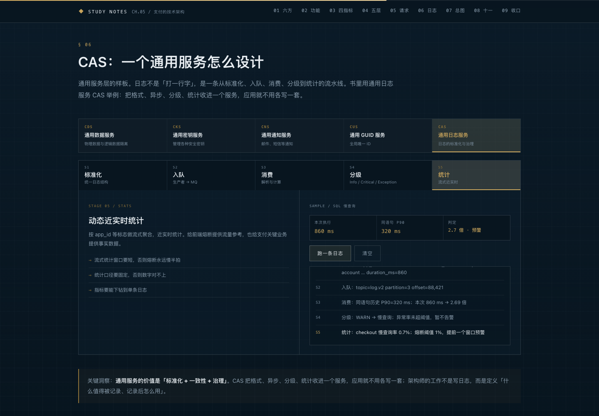
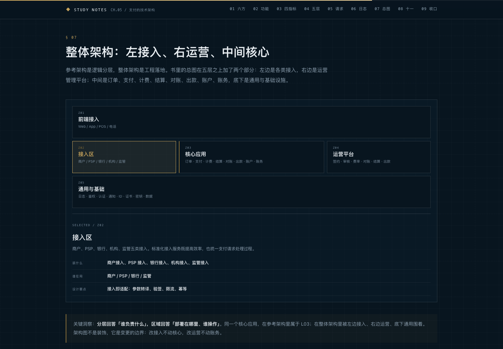
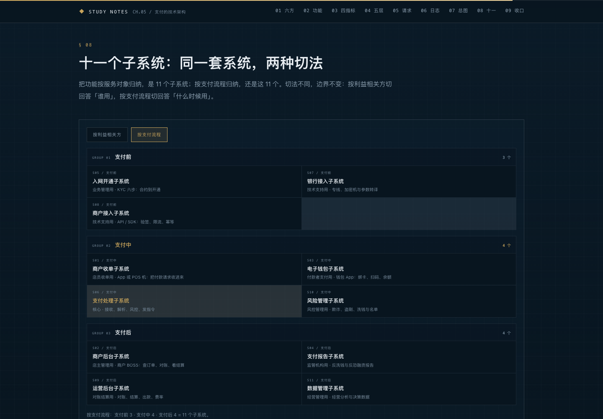

# 先数清六方，再盖五层楼：支付的技术架构是怎么长出来的

支付的技术架构，最终要回答的不是「用什么中间件」，而是「六方各自要什么、这些诉求怎么落到功能、功能又怎么砌进分层」。这一章把六方诉求、支付前中后三段、四个硬指标、OSI 七层到支付五层、一笔请求的旅程、CAS 与 11 个子系统摆在一起，只回答一个问题：这栋楼为什么必须这样盖。

**关键词**: 支付技术架构、利益相关方、KYC、高可用、单笔成本、水平扩展、参考架构、OSI 七层、五层架构、CAS、通用服务、子系统划分

> **核心结论**：支付架构不是先挑中间件，而是先把六方的诉求数清：谁要按时收到钱、谁要按时收到货、谁要对账、谁要看合规。诉求变成功能，功能按支付前、中、后三段落位，再砌成五层楼和十一个子系统。分层不是为了图好看，是为了让每一层只解决一类问题，层与层之间只认接口。

## 1. 架构不是技术清单，是六方的诉求清单

很多团队做支付架构，第一张图就是「网关 + 核心 + 数据库 + 消息队列」。这张图没有错，但它回答不了最重要的问题：这些组件，到底在替谁解决什么问题。

支付生态里有六个主体。每一个都有自己的核心诉求，也都有一组必须履行的义务。

| 主体 | 核心诉求 | 要履行的义务 | 对架构的硬约束 |
|---|---|---|---|
| 收款人（商户） | 在合约时间内收到约定金额 | 按时、按质、按量发货，提供发票与发货信息 | 收单覆盖 App / POS / 扫码；能按日对账；接入要快 |
| 付款人（消费者） | 在合约时间内收到约定数量与质量的货或服务 | 按时、按量完成对应资金的支付 | 支付要快、状态可查；钱包覆盖在线 / 扫码 / 余额；大额能加验 |
| 银行 | 按支付指令按时按量完成资金转移，赚取服务费 | 按约定时间与支付机构对账；帮助完成结算后的出款 | 专线加硬件加密机；报文参数解析与转译；对账子系统 |
| 银行卡组织 | 高效且安全地提供银行卡服务，赚取处理费 | 通过发卡行提供网络与授权认证；连接收单行与开户行 | 卡组织报文规范；授权与清算两步；跨行差错处理 |
| 支付机构 | 准确、准时、安全地完成资金交割 | 代商户发扣款指令；管理信用卡风险；配合反洗钱调查 | 商户接入加银行接入；风控与合规；备付金管理与报告 |
| 监管机构 | 支付活动符合法律与规范 | 要求定期上报支付请求；核查可疑交易 | 反洗钱系统；备付金报告与集中；对接公安、外汇局、央行相关部门 |

这张表只说明一件事：**架构的第一性原理是诉求，不是技术**。收款人要的是「钱按时到」，付款人要的是「货按时到」，银行要的是「对得上账」，卡组织要的是「授权安全」，支付机构要的是「交割准确」，监管要的是「看得见、管得住」。

图上六张主体卡围成一条链路，当前选中的是收款人：左侧写「在合约规定的时间内收到约定数额资金」，右侧写收单、对账、接入三条约束；链路条同时高亮收款人所在的位置。

**关键洞察**：每一条诉求都必须有功能承接，每一个功能都必须有系统落点。六方里少照顾一方，架构就会在某一段长出补丁——少了对账，结算就对不平；少了监管报告，合规就过不去；少了幂等，重试就会重复扣款。

## 2. 同一批功能，按时间排成三段

六方的诉求落到支付机构身上，会变成一组功能。这些功能最自然的排法不是按团队，也不是按技术栈，而是按时间：支付前、支付中、支付后。

| 阶段 | 主要功能 | 这一段的产物 | 回答的问题 |
|---|---|---|---|
| 支付前 | KYC 六步：合约、申请、审核、批准、接入、开通；再加银行接入与商户接入 | 已签约商户、可用商户号、已连通银行通道 | 这个人、这个商户，能不能做这笔生意 |
| 支付中 | 接收、解析、风控、形成指令、发送指令、结果通知、分账计费、账户账务、客户服务 | 银行返回的支付结果、待结算商户余额、手续费与分账记录 | 这笔请求能不能变成银行能执行的指令 |
| 支付后 | 账务、账户、对账、结算、出款、报告 | 对平的对账单、结算单、出款流水、监管报告 | 钱到底有没有、有多少，什么时候给商户 |

三段里最容易被误解的是「支付中」。很多人以为支付中就是扣钱，其实支付中做的是翻译：把商户的请求，翻译成银行或其他金融机构能理解、能执行的支付指令。

**关键洞察**：支付中完成的是银行之间的资金交割；真正把消费者付的钱转给商户，是支付后完成的。所以「支付成功」不等于「商户已经拿到钱」，中间还隔着账务、对账、结算与出款。

图上三个标签页按时间排开，当前停在「支付中」：左侧列出接收请求、解析、风控、形成指令、发送指令、结果通知、分账计费、账户账务、客户服务九项功能，右侧标出这一段的三类产物。

## 3. 四个硬指标：停机预算、单笔成本、加机器

支付和游戏、短信、直播、电商都不一样：它处理的是资金，所以四个指标不是「越高越好」的形容词，而是有下限的验收线。

**高可用**：核心系统至少 99.99%，最好 99.999%。这两个数字必须换算成时间，才有意义。

一年 365 天、每天 24 小时，一共 525,600 分钟。99.99% 允许停 52.6 分钟；99.999% 只允许停 5.26 分钟。多一个 9，允许停机时间缩到十分之一。

**高效率**：支付机构的收入来自手续费，典型费率是交易金额的 1%——100 元的交易，最多收 1 元。所以单笔成本必须随规模往下走。

单笔成本 = 年运维成本 / 年支付笔数。这里的分母是「所有支付请求的个数，含退款和取消」，不是成功交易数。

**可扩展**：外部请求涨了，不改应用程序，只加资源就能扛住。它的天敌是锁表：所有请求都抢同一行数据，加多少机器都只能排队。

书里有一个真实的失败案例：2015 年某电商联合手机厂商做促销，上万笔支付请求在不到 10 秒内涌入；每笔都要锁商户账户去更新余额，数据库来不及响应，系统完全瘫痪，活动失败。

图上按年换算可用性：99.99% 对应 52.6 分钟 / 年；下方把促销洪峰拉到 1,000 TPS、持续 10 秒，示例单库容量 300 TPS，10 秒内共 10,000 笔请求，排队积压 7,000 笔，状态显示「请求排队 · 锁表冲突」。

**关键洞察**：可用性和安全性是门槛，效率和扩展性是生意。前两个决定「能不能开门」，后两个决定「能不能赚钱」。

这里有一笔必须单独算的账：假设年运维成本 3,600 万元、日支付 100 万笔，一年就是 3.65 亿笔，单笔成本 = 3,600 万元 / 3.65 亿笔 ≈ 0.0986 元。按 1% 费率、客单价 100 元计算，单笔收入 1.00 元，成本占收入 9.86%。

这笔账和上面那笔 100 元订单不是同一个口径：一个是年成本池除以年笔数，一个是单笔交易的金额与费率，不能混着乘。

**容易读错的三处**：

1. 99.99% 不是「四个九的形容词」，是 52.6 分钟 / 年；99.999% 是 5.26 分钟 / 年，差一个 9 就是十倍。
2. 单笔成本的分母是支付总笔数（含退款与取消），不是成功交易数；它更适合纵向自比，不适合直接拿来和别家横比。
3. 日 100 万笔、年成本 3,600 万元是示例口径，和 2015 年「10 秒上万笔」的洪峰不是同一笔账。

## 4. 参考架构：OSI 七层给的是方法，不是模板

分层不是支付发明的。1984 年公布的 ISO OSI 七层模型，本来是为了解决异构网络互联的兼容性问题；它最大的贡献不是七个名字，而是把「服务、接口、协议」三个概念分开了。

支付借的是这个思路，不是照搬七层。支付的参考架构把自己的应用分成五层：

| 层 | 装什么 | 失败会怎样 | 设计要点 |
|---|---|---|---|
| L05 前端应用层 | iOS / Android App、Web、收银台、电子钱包、POS App | 用户点不下去，后面全白搭 | 只负责交互与展示，换前端不该改一次账 |
| L04 接入网关层 | API 网关、商户接入网关、金融系统与银行网关 | 请求进不来，或者指令出不去 | 接入即适配：验签、限流、幂等、参数转译 |
| L03 核心业务层 | 客户信息、业务管理、费率、支付请求、分账计费、账户账务、对账结算、出款报告 | 支付失败，或者账对不平 | 核心只认内部模型，承担最重的数据一致性 |
| L02 通用服务层 | 日志、数据、通知、鉴权、认证、GUID、风控 | 局部故障扩散成全局故障 | 只做大家都需要的事，标准化才能统一治理 |
| L01 基础设施层 | 网络、计算、存储、安全、域名、时间、数据库、备份、灾备、多环境 | 地基塌了，上面全停 | 环境隔离本身就是架构能力 |

图上左侧是 OSI 的七层，右侧是支付的五层，当前选中核心业务层：中间写明这一层装客户信息、业务管理、费率、支付请求、分账计费、账户账务、对账结算与出款报告，右侧标注「支付失败，或者账对不平」。

**关键洞察**：分层的收益不是「图好看」，是「每层只解决一类问题，层间只认接口」。OSI 把服务、接口、协议分开；支付五层同理：核心层不该关心银行报文长什么样，网关层也不该自己改账。

## 5. 一笔 100 元请求，怎么穿过五层

把一笔 100 元的订单放进五层，旅程大致是这样：

| 站 | 发生什么 | 示意时延 |
|---|---|---|
| 01 前端 | 收银台提交订单 ORD-20261122-001，金额 100.00 元 | T+0 ms |
| 02 商户网关 | 验签通过；限流 1,200 TPS；幂等键首次出现 | T+15 ms |
| 03 核心 | 风控通过；生成扣款指令 PAY-8842；计费 1.00 元，分账 99.00 元 | T+45 ms |
| 04 落库 | 先把指令与状态写进数据库，状态 = SENT_PENDING | T+70 ms |
| 05 银行网关 | 指令转译为银行报文；专线发送；加密机签名 | T+90 ms |
| 06 银行 | 扣款成功，返回 RC=00，授权码 661208 | T+220 ms |
| 07 记账 | 商户待结算 +99.00，手续费 +1.00，分录与幂等键一起落库 | T+260 ms |
| 08 通知与日志 | 通知推送；日志 trace_id 落盘 | T+300 ms |
| 09 结果上屏 | 收银台显示支付成功；订单状态变为 PAID | T+320 ms |

第 4 站是最容易被跳过、也最贵的一站：外发银行之前，先把指令与状态写进数据库。否则进程重启后，系统不知道这笔请求到底发没发出去——重发可能重复扣款，不发可能丢单。

图上播放到第 4 站「核心：先把指令落库」：右侧日志依次出现前端提交、网关验签与限流、核心生成指令，最后一行是「数据库写入支付指令 PAY-8842，状态 = SENT_PENDING；这是一次同步落库」。

**关键洞察**：支付系统里，状态必须先于动作持久化。指令没有落库就发出去，等于把「发没发过」交给运气。

这里的时间数字 0–320 ms 是站点用来说明层次关系的示意值，不是真实系统指标，不能拿来当 SLA。真实系统里，银行这一段往往是整条链路里最不可控的。

## 6. CAS：通用服务应该怎么设计

通用服务层的价值，用一个日志服务就能看明白。书里以 CAS（Common Applications logging Service，通用日志服务）为例，给出了一条五段流水线：

| 段 | 做什么 | 不做会怎样 |
|---|---|---|
| 01 标准化 | 统一 app_id、level、ts、trace_id、sql / event、duration_ms | 每接一个应用就写一套解析，跨应用排障断链 |
| 02 入队 | 应用只格式化并投递消息队列，写日志从同步变异步 | 日志洪峰直接冲击应用 I/O 与网络 |
| 03 消费 | 从队列取日志，按规则深度处理，算执行时长与历史分位 | 日志只是文本，变不成可比较的事实 |
| 04 分级 | Info 计数存储；Critical 分析判别；Exception 深入分析或告警 | 所有日志都告警，等于没有告警 |
| 05 统计 | 按 app_id 流式聚合，近实时统计，给熔断提供流量参考 | 熔断永远慢半拍，指标对不上 |

书里给了一个能自己复算的例子：一条慢 SQL 日志显示本次执行 860 ms；同一条语句的历史 P90 是 320 ms。860 / 320 ≈ 2.69，也就是这次比它自己的常态慢了约 2.7 倍。

如果只看「860 ms」这个绝对值，我们不知道它算不算慢；拿同语句的历史分布做基线，才有判断。

图上流水线走到最后一段「动态近实时统计」：右侧日志已完整出现标准化、入队、消费、分级、统计五行，关键结论是本次 860 ms 对同语句历史 P90 320 ms，约 2.69 倍；统计段给出 checkout 慢查询率 0.7%，熔断阈值 1%。

**关键洞察**：通用服务不是「把工具包放一起」，而是「把大家都要遵守的规则收进一个服务」。CAS 真正的产出不是日志文件，是统一的字段、统一的链路 ID、统一的分级与统计口径。

落到工程上，日志的第一要件不是「全」，是「能串起来」。trace_id 缺一个，跨应用排障就断链；duration_ms 缺一个，就永远只能靠感觉判断快慢。

## 7. 总图与十一个子系统：两种切法，一套边界

参考架构回答「谁负责什么」，整体架构回答「部署在哪里、谁操作」。书里的总图在五层之上加了两个部分：左边是各类接入，右边是运营管理平台；中间是订单、支付、计费、结算、对账、出款、账户、账务，底下是通用与基础设施。

| 区域 | 装什么 | 谁在用 | 设计要点 |
|---|---|---|---|
| 前端接入 | Web、App、POS、电话接入 | 付款人、商户店员 | 标准化 API 与 SDK，不各自直连核心 |
| 接入区 | 商户、PSP、银行、机构、监管五类接入 | 商户、PSP、银行、监管 | 接入即适配：参数转译、验签、限流、幂等 |
| 核心应用 | 订单、支付、计费、结算、对账、出款、账户、账务 | 全链路 | 只认内部模型，守住数据一致性 |
| 运营平台 | 签约、审核、费率、对账、结算、出款 | 支付机构运营、商户后台 | 人的操作与审核，不绕过核心规则 |
| 通用与基础 | 日志、鉴权、认证、通知、ID、证书、密钥、数据 | 所有服务 | 标准化、可复用，避免各写一套 |

把这套功能按「服务对象」归纳，就是 11 个子系统；按「支付流程」再切一次，还是这 11 个：

| 按支付流程 | 子系统 | 服务对象 |
|---|---|---|
| 支付前 3 个 | 入网开通、银行接入、商户接入 | 支付机构、银行、商户 |
| 支付中 4 个 | 支付处理、商户收单、电子钱包、风险管理 | 支付机构、商户、消费者 |
| 支付后 4 个 | 商户后台、运营后台、支付报告、数据管理 | 商户、支付机构、监管 |

图上五个区域排成一张总图，当前选中「接入区」：写明商户、PSP、银行、机构、监管五类接入，设计要点是「接入即适配：参数转译、验签、限流、幂等」。

图上切到「按支付流程」视图：支付前 3 个、支付中 4 个、支付后 4 个，加起来仍是 11 个子系统；每张卡标注子系统编号、使用方与一句话职责。

**关键洞察**：两种切法不是两套系统。按利益相关方切，回答「谁用」；按流程切，回答「什么时候用」。边界不变，只是视图变了。

## 8. 架构错误最贵的地方

支付架构的错误不会平均分布，它们集中在几个「看起来只是一个设计选择」的位置：

| 层 | 出事的样子 | 代价 | 我们盯什么 |
|---|---|---|---|
| 接入 | 没有幂等键，重试就重复提交 | 重复扣款、重复发货 | 幂等键在网关生成、核心消费、账务落库三处一致 |
| 核心 | 指令未落库就先外发 | 不知道发没发出去，重发或丢单 | 状态机五态：未发、已发待结果、成功、失败、未知 |
| 核心 | 直接耦合每家银行的报文格式 | 每接一家银行改一次核心 | 银行网关只做转译，核心只认内部模型 |
| 通用 | 日志没有统一 trace_id | 跨应用排障断链，故障定位靠猜 | 全链路一个 ID，字段与分级统一 |
| 支付后 | 对账缺失或只对总额 | 结算对不平，备付金算错 | 逐笔对账、差异分类、差错处理闭环 |
| 基础设施 | 单库锁表扛洪峰 | 促销一开始，系统先瘫痪 | 水平扩展、分库分表、热点账户隔离 |

### 三条铁律

1. **先数诉求，再画分层。** 每一层都要能回答「我替谁解决什么问题」，答不上来的层，大概率是组织架构的投影，不是系统边界。
2. **先落库，再外发。** 没有持久化状态的指令，等于没有指令；「未知」必须是一种被设计过的状态。
3. **接入即适配，核心只认内部模型。** 通用服务只做大家都需要的事；每接一家外部机构就改一次核心，扩展性已经输了。

### 四个自测问题

1. 六方各自的诉求是什么？少照顾哪一方，会在支付前、中、后的哪一段长出补丁？
2. 99.99% 和 99.999% 各允许停多少分钟 / 年？为什么差一个 9 就是十倍？
3. 支付前、支付中、支付后各产出什么？「真正把钱给商户」发生在哪一段？
4. 五层各装什么？一笔请求为什么必须先落库再发银行？11 个子系统的两种切法，为什么不是 22 个系统？

## 参考资源

- 原书：陈斌《一本书读懂支付》第 5 章「支付的技术架构」
- 豆瓣条目：https://book.douban.com/subject/36422205/
- 可视化页面（含六方诉求切换、支付前中后三段、可用性换算与洪峰滑杆、OSI 七层与支付五层双栈、请求旅程播放、CAS 慢 SQL 流水线、整体架构五区域、11 子系统两种切法）：https://baixiaoustc.github.io/notes/payment-primer/ch05/
